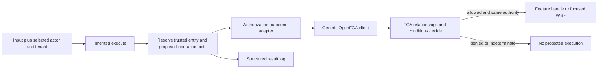

# Authorization Platform Context

Proposed design: [SPEC-EP-00-F01 revision 4](specs/EP-00-F01-govern-scoped-access.md), **Awaiting approval**. Updated: 2026-10-28, America/Sao_Paulo. No ADR, code or product status is approved by this document.

## Purpose and current state

[EP-00](../product/epics/00-authorization-first-validation/00-epic.md) begins with complete [F01](../product/epics/00-authorization-first-validation/01-govern-scoped-access.md). Its [security](../product/requirements/00-andromeda-manufacturing-product-foundation/12-security-access-auditing-and-change-control.md) and [operating-model](../product/requirements/00-andromeda-manufacturing-product-foundation/04-operating-model-and-master-data.md) requirements supply the tenant/action/scope boundaries. This repository contains backend package/build/test configuration, not implemented authorization or business records.

The requester wants OpenFGA to perform the authorization work it supports. Revision 4 removes local administrative ceiling/action/window/self/onward policy comparisons: proposed-operation facts go to OpenFGA conditions and relations, which decide. The application keeps basic names/mappings, real business data, input/data integrity, provider adaptation and structured logging. There is no new change-request workflow, audit database, graph engine, locking/fence, snapshot/rebuild or reconciliation framework.

## Responsibility and storage

| Owner/place | Responsibility |
| --- | --- |
| Ordinary application database | Actors/status, tenant memberships, location parents, machine location, old order/event machine/history fields and fixed group identities. These are business facts, not a second permission graph. |
| Minimal bootstrap | Registered action/resource identifiers, their provider mapping, trusted provider model/store binding and registration of authorization-relevant relationships as entities change. |
| Trusted FGA model/configuration | Authorization scheme: operational relationships, scope inheritance, group/independent sources, administrative ceilings, validity, self/onward restrictions and inactive-member gates. |
| FGA tuples | Runtime memberships, parent evaluation edges, grants, group sources, management authorities and their persisted conditional policy parameters. |
| Reusable application authorization mechanism | Preserve inherited `execute` → provider decision → `handle` only on allow, shared across protocols. Resolve trusted facts; no local effective-grant or ceiling calculation. |
| Authorization outbound adapters | Translate domain names and unchanged proposed operations into FGA Check/Write. Keep a created dependent source bound to the same specifically allowed authority. |
| `platform/openfga` / configuration | Generic SDK/client, credentials and transport, with no business-module imports. Wire injects semantic adapters through inward interfaces. |
| Structured logger | Actor/tenant/action/resource/result/time and recipient/source/authority when relevant; supporting information, not an authority or full historical-query product. |

OpenFGA does not read the application database. The application registers the relevant parent/membership facts when records change and supplies literal current actor/membership status values and time as trusted Check context. It does not send every role, location and grant on each invocation. Its small action catalog is vocabulary/mapping, not a TypeScript policy engine.

## Provider-decided management and runtime flow

A normal good-report request becomes `actor:ta/u-operator` / `can_report_good` / `resource:ta/machine/m1a` with trusted time and literal actor/membership status values. Existing FGA direct/group/parent relationships decide. A management request also provides proposed action, real recipient and requested validity/inheritance. A stored conditional management authority decides whether it may be written; its scope comes from graph inheritance. The [spec's native Check example](specs/EP-00-F01-govern-scoped-access.md#delegated-changes-are-decided-by-fga-before-write) demonstrates inside-ceiling allow and action/scope/end/self/onward denial in FGA.

Write does not automatically authorize its initiating platform actor: the adapter performs the management Check(s), requires the complete allow and then writes the unchanged operation. Existing source cleanup has a distinct policy branch so an inactive recipient/expired source does not prevent authorized revocation. Group-mediated self/cycle/affected-source questions use FGA decisions; application code does not traverse an effective-permission graph. Arbitrary prospective/global graph invariants and Check→Write atomicity are not supplied by CEL or claimed by this design.

The actual adjacent `AuthorizedUsecase` base and Keycloak provider/port/wire were reread on 2026-10-28. Preserve base-owned authorization-before-handle and replaceable outbound provider boundaries. The reference demonstrates Keycloak user creation, not an implemented deactivation flow. Tenant-local suspension removes the selected FGA active-member edge and leaves DUAL's other tenant independent. A future global account lifecycle may require a separate Keycloak disable call; F01 does not implement authentication/provisioning or globally disable an account for one tenant's membership change.

## Explicit limits and source alignment

Check followed by handle/Write is not atomic with concurrent revocation or a business database update. An earlier allowed invocation may finish after revocation acknowledgment; SQL/FGA parent writes may disagree during a partial update. Current status supplied to the FGA condition refuses a newly inactive subject even if tuple cleanup failed, but no general cross-system transaction is claimed.

Structured logs/current-source reads do not provide complete protected historical path investigation. These AC06/BR06/inspection source gaps remain visible in revision 4. Product text/status is unchanged; no rejected coordination or diagnostics framework is reintroduced to conceal the limits.

## References and delivery

Official documentation and the pinned [OpenFGA 1.22.0](https://github.com/openfga/openfga/releases/tag/v1.22.0) / [JavaScript SDK 0.9.7](https://github.com/openfga/js-sdk/releases/tag/v0.9.7) baseline were researched previously. On 2026-10-28, [conditions](https://openfga.dev/docs/modeling/conditions), [tuple Write](https://openfga.dev/docs/getting-started/update-tuples), pinned SDK transaction semantics and the [server CEL evaluator](https://github.com/openfga/openfga/blob/v1.22.0/internal/condition/condition.go) were rechecked for the revised management design. The spec retains the complete [reference register](specs/EP-00-F01-govern-scoped-access.md#official-reference-register).

The supplied manufacturing [README](https://github.com/openfga/sample-stores/blob/fc35d2e3a2413386d663d90864ad51715f80f78e/stores/manufacturing/README.md), [model](https://github.com/openfga/sample-stores/blob/fc35d2e3a2413386d663d90864ad51715f80f78e/stores/manufacturing/model.fga) and [tuples/tests](https://github.com/openfga/sample-stores/blob/fc35d2e3a2413386d663d90864ad51715f80f78e/stores/manufacturing/store.fga.yaml) inform hierarchy and executable assertions. Their broad admin/manufacturing/member policy is not adopted. The proposed Andromeda conditions/model still require real-provider execution; documentation review is not runtime evidence.

| Feature | Spec | ADR / implementation |
| --- | --- | --- |
| F01 — first dependency-ready feature | [SPEC-EP-00-F01](specs/EP-00-F01-govern-scoped-access.md), revision 4, Awaiting approval | Not created / not started |
| F02–F10 — remaining epic features | Not created | Not created / not reported |

Only F01 is specified, with explicit gaps against the broader original source. Its probes do not implement later manufacturing effects. Next checkpoint is revision 4 review; no additional spec or implementation is authorized here.
