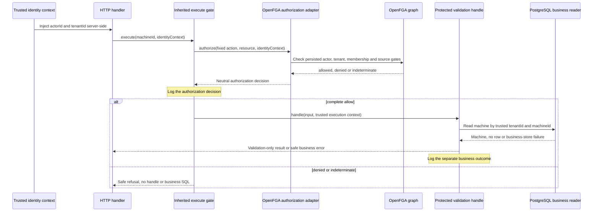

# SPEC-EP-00-F01 — Design

**Package revision 6 · 2026-10-30, America/Sao_Paulo · M0 Approved · implementation in progress: M0-01/M0-02/M0-03 reviews accepted; next task not started · F01 incomplete.**

[Requirements and state](EP-00-F01-govern-scoped-access.requirements.md) → Design (this document) → [Tasks](EP-00-F01-govern-scoped-access.tasks.md).

## Reading guide and approval boundary

The main path is simple: **trusted identity context → OpenFGA decision → protected business operation**. Read the flow, responsibility and failure sections first; complete contracts/model are reference material for implementation. Stop at the M0 reading boundary and continue to Tasks. The historical appendix preserves superseded proposals, not current implementation instructions.

The user explicitly approved revision 6's M0 technical design on 2026-10-30, America/Sao_Paulo. [ADR-0001](../adrs/0001-m0-graph-authoritative-authorization-foundation.md) records the accepted M0 decisions. The approval session did not authorize implementation. The user subsequently requested the first task's implementation in a new context on the same date. M0-01 configuration is implemented and reorganized at the user's request into separate database/runtime configuration folders and schema/error/interface/loader files, with a configuration-only `main.ts`. Its behavior is unchanged: 33 unit tests, strict typecheck, build and two built-entrypoint smoke scenarios passed; user review was accepted on 2026-10-30, America/Sao_Paulo. Future F01 milestones and G01–G04 require their own reviewed designs. The [Backend handoff](EP-00-F01-govern-scoped-access.requirements.md#backend-handoff--approved-revision-6-m0) and [execution evidence](EP-00-F01-govern-scoped-access.tasks.md#execution-evidence) record the current stage and limits; approved design contracts remain unchanged.

**Current execution — 2026-10-30:** M0-02 is implemented, compiler-validated and accepted by the user's instruction to continue to task 3. Authorized M0-03 adds `RepositoryError` and `RepositoryUnavailableError` with native optional `ErrorOptions` and no infrastructure imports. Strict compilation and a focused temporary runtime check passed; user shared errors review was accepted on 2026-10-30, America/Sao_Paulo. Driver classification and HTTP mappings are not implemented in this stage; the approved design contracts are unchanged and M0-04 has not started.

## One request, from identity to authorization to business data



The authorization adapter implements the application's neutral capability directly. It has a generic FGA client and pinned configuration, **no SQL repository and no entity/status resolver**. The inherited base calls it once per invocation and only then admits the protected handler. The handler's business reader is a separate dependency behind this gate.

## Identity now and later

The provider-neutral `IdentityContext` contains only `actorId` and `tenantId`. Today a controlled runner injects it once per app instance from trusted fixture configuration. Later the authentication layer validates the token and produces the same contract. Authentication, JWT verification and Keycloak integration are deferred to their own delivery; the fixture does not authenticate an external person.

A future signed token identifies the subject/selected tenant. Its status, role or membership assertions are not current authorization truth. Mutable enabled/member/permission relations stay in OpenFGA. No token/request contextual tuple can recreate a membership removed from the persisted graph.

The application declares the fixed action `quantities:good:report`. The body contains only `machineId`; the adapter constructs the tenant-addressed resource from the trusted context. Body/query/header identity, status, role, tuple or provider-configuration fields cannot replace that context. Strict body validation rejects unknown fields; identity-looking headers are ignored. No arbitrary FGA relation/string is accepted from clients.

`ENABLE_AUTHORIZATION_VALIDATION` defaults to false. When enabled, the controlled demo listens on loopback and registers the route only after business bootstrap and exact provider binding verification. The runner selects contexts from its trusted fixture manifest, including deliberately disabled actors/tenants, inactive memberships and OUTSIDER negative cases. No per-request SQL lookup is used to construct/refresh identity. Unknown fixture selections fail setup.

## Responsibilities and storage

| Owner | Current responsibility |
| --- | --- |
| Shared application identity/base | Neutral identity/request/decision and one inherited allow-before-handle boundary, reusable across future protocols. |
| OpenFGA authorization outbound adapter | Map trusted global actor, selected tenant, fixed action/resource and binding; validate the provider result. No business-module entity imports or SQL. |
| OpenFGA model and persisted tuples | Global actor enabled, tenant enabled, active membership and valid action-specific grant source. These gates decide current authority. |
| Generic platform/config | SDK, transport, timeout, credentials and pinned model/store. No business policy or automatic lifecycle synchronization. |
| Protected validation application | After allow, read the business machine using the same trusted tenant and ID; return validation-only result or business error. |
| PostgreSQL business modules | Retained tenant, actor-directory, membership-directory, location and machine data, mappings and tenant-safe constraints. Directory status fields are projections, not authorization inputs. |
| Structured logger | Correlated authorization decision and subsequent business outcome. Permission allow is never represented as business success by itself. |
| Controlled initializer | Explicitly seed business records and graph state and verify their known baseline before readiness. Not a public administration API. |

Application PostgreSQL is used for business concerns. OpenFGA may itself use its own PostgreSQL datastore; this internal provider storage does not introduce an application SQL read into Check.

## Minimum graph contract

A protected action requires **all four**:

1. The global actor's `enabled` userset contains that actor.
2. The selected tenant's `enabled` gate exists and is bound to that selected tenant.
3. The actor participates through the tenant's `member` relation referencing the enabled userset.
4. A matching, independently identifiable direct source grants the requested action on that resource.

An active membership alone gives no reporting permission. A grant alone cannot bypass a disabled actor/tenant or missing membership. An access-administrator label gives no manufacturing authority.

Use global actor IDs such as `actor:u-operator`, matching the globally identified SQL actor. Membership points to `actor:u-operator#enabled`. Removing the single self-enabled tuple disables the actor's effective participation across tenants without enumerating grants. Suspending only A membership removes that userset's A member edge and leaves B independent. Disabling tenant A removes A's tenant-enabled tuple; it does not disable B or globally disable any actor.

Tenant context is bound with a small condition: the tenant-enabled tuple persists `expected_tenant_id`, and Check supplies `selected_tenant_id` from trusted `IdentityContext`. This is tenant selection, **not a supplied status or entitlement**. Grant and resource both require membership through their own tenant; a B source cannot authorize an A operation even for DUAL with memberships in both. Missing/evaluation-error required context is indeterminate, never permission.

All future protected operational **and administrative** relations must retain equivalent actor/tenant/membership gates. There is no automatic global filter applied by OpenFGA: a future relation that omits them would be a model bug and must be caught by regression tests. Future whole-tenant reactivation needs explicitly scoped control authority outside the disabled tenant's operational gate; that belongs to its own lifecycle-feature design, not an M0 bypass.

### Lifecycle APIs are application features

These relation names are application-defined policy, not built-in user/tenant status CRUD. An appropriately authorized lifecycle feature will translate its exact operation into native `POST /stores/{store_id}/write` writes/deletes. The service credential can mutate FGA data; it does not automatically authorize the human/agent initiator. The feature must Check the protected administrative operation first.

M0 seeds and tests gate changes directly in isolated fixtures. It delivers no runtime actor, tenant or membership administration endpoint. Tenant-membership suspension/removal remains later F01; global-actor and whole-tenant lifecycle workflows are separately scoped future features. OpenFGA does not automatically observe SQL changes, subscribe to Keycloak or disable an IdP account. No webhook/synchronization subsystem is added here.

A bounded FGA Write is atomic within FGA, not with SQL/IdP/business effects and not with an earlier Check. Unknown write completion, accepted-operation ordering, registration/relocation consistency and recovery remain G01/G02 work. Acknowledging a lifecycle change as effective must follow its future reviewed contract; a timed-out write is not asserted successful.

## Protected business read and safe HTTP results

`POST /api/v1/authorization/validate-good-report` strictly accepts `{machineId}`. The authorization adapter maps to `resource:<trusted-tenant>/machine/<machineId>` without reading the business database. Unknown or foreign graph references normally deny safely before any business SQL.

Only an allow invokes `ValidateGoodReportUsecase.handle` with a trusted execution context containing the original identity and a server-generated invocation ID. The handler calls its machine repository once with `(tenantId,machineId)`. It does not look up actor/status/membership or infer authority from SQL. An existing row returns:

```json
{
  "error": false,
  "data": {
    "validationOnly": true,
    "permission": "allowed",
    "action": "quantities:good:report",
    "resource": { "kind": "machine", "id": "m1a" },
    "manufacturingEffect": "none"
  }
}
```

No quantity, order transition or equipment command is created. A decision applies to this invocation only.

| Condition | Safe HTTP result | Business read |
| --- | --- | --- |
| Complete allow and matching SQL row | 200, explicit validation-only result | Once, tenant-scoped |
| Malformed body/unknown fields | 400, invalid request | None |
| Missing injected identity | 401, identity unavailable | None |
| Graph denies, including unknown/foreign reference or disabled gates | 403, action not permitted | None |
| Provider timeout/unavailable/invalid result/required-context evaluation error | 503, authority could not be established | None |
| Graph allows but no matching tenant-owned SQL machine exists | 404, resource unavailable | Once after allow |
| Graph allows, then recognized business-store connection/outage failure | 503, business operation unavailable | Attempt after allow |
| Generic `RepositoryError` or unexpected application failure | 500, generic internal error | Only if reached after allow |

The existing `{error:true,message:<safe message>}` envelope remains. Provider-indeterminate and known business-unavailable 503 messages/categories are distinct. Generic SQL bugs/constraint/mapping errors do not become availability claims: preserve generic500 under the modular baseline. A shared `RepositoryUnavailableError` category represents only recognized connection/outage failures. Do not return raw SQL/SDK errors, provider IDs, tuple/path contents or foreign metadata.

Startup still requires the configured business database for business migrations/seeds and route assembly. This is a service-bootstrap prerequisite, not a query added before every Check. After startup, an unavailable business database cannot change a graph denial or the correctness of an allow: denial needs zero SQL; an allowed validation subsequently fails its business read. Tests keep the provider/datastore independently available while interrupting only business storage.

## Logging permission separately from operation outcome

The inherited base generates an invocation ID and emits one `authorization.check` event for allow/deny/indeterminate, including safe identity/action/resource/time/version fields. It passes the same ID with trusted identity into the protected handler. The adapter/base never log token claims or raw provider responses as authority.

Only a handler that actually runs emits `validation.completed`, with the same invocation ID and one outcome: `completed`, `resource_unavailable`, `business_unavailable` or `failed`. Include the requested tenant/resource/action and sanitized category/time. An allowed check followed by a business503 therefore has **two truthful events**, not a rewritten denial or a false operation success. Denied/indeterminate checks emit no business-completed event.

Logs are supporting information; they are not a transaction, durable path proof, permission source or historical-query product. Destination access/retention is environment-owned. G03 retains the full protected-history requirement without introducing an audit framework now.

## Business data and initialization

Keep the five SQL contracts/mappings and same-tenant foreign keys from the previous proposal. `Machine.locationId` remains required; parent/location relationships and original machine identity are ordinary business data. Actor/membership directory status fields may be stored for business views, but the authorization adapter neither reads nor trusts them. Future lifecycle features must define any projection update/recovery explicitly; no automatic SQL/FGA synchronization is implied.

Use string primary IDs, unique `(tenantId,actorId)` membership, unique `(tenantId,id)` resource keys and composite same-tenant location/machine foreign keys. Reused `(tenantId,code)` values stay distinct across A/B. Root location parent and optional actor owner map SQL null to omitted TypeScript fields. Fixed seed validation checks plant→area→line kinds/cycles. Migrations are versioned/transactional with `synchronize:false` and packaged SQL assets; no public hierarchy editor is delivered.

The baseline has exactly tenants `ta`/`tb`, minimal plant/area/line records, A machines `m1a`/`m2a` and B machine `m1b`. Actor IDs are `u-operator`, `u-owner`, `u-none`, `u-disabled`, `u-dual`, `u-outsider`, `u-b-operator`. All are globally enabled initially; `u-disabled` is the inactive **A membership** fixture, not a globally disabled actor. Active graph memberships are A operator/owner/none/dual and B operator/dual. SQL business-directory memberships mirror that initial fixture; u-disabled has a suspended A directory row and no active graph member edge, OUTSIDER has no membership. No actor label grants an operation.

Only A-OPERATOR→A-M1 and B-OPERATOR→B-M1 have baseline good-report sources. DUAL's existing product read-only A/start-only B meaning is not replaced by new baseline reporting rights. The isolated `dual-report` model/E2E variant explicitly adds direct reporting sources on A-M1/B-M1 to test both-tenant source gates, global disable and wrong-tenant source linkage, then disposes/resets that fixture. An isolated orphan-resource variant grants an A graph address without a corresponding SQL machine to prove post-allow404.

### Explicit provider setup and binding

Retain pinned OpenFGA **1.22.0** and SDK **0.9.7** for the controlled baseline. Generic config and client have separate review gates. Use a real PostgreSQL-backed FGA datastore separate from application tables/database; tests use independent provider/business datastore instances so business-outage tests do not also stop FGA. Preserve provider state across backend restarts; dispose it only when an isolated fixture environment is explicitly torn down. No root infrastructure change, broker, Keycloak or AWS service is needed.

1. Start infrastructure and apply provider datastore migrations/readiness.
2. Apply application business migrations and its deterministic SQL seed transaction.
3. Explicitly initialize a controlled store with the new readable `model.fga` and equivalent uploadable `model.json`; keep model assertions/fixture variants in `store.fga.yaml`.
4. Write the bounded current-model tuples in one FGA transaction and verify known baseline checks. SQL and FGA seed writes are separate transactions; partially initialized fixtures never become ready.
5. Emit the private binding manifest: `storeId`, `authorizationModelId`, canonical model SHA-256, **policyVersion `authorization-m0-v2`** and scenarioVersion `ep00-m0-v2` (with explicit variant suffixes for isolated cases).
6. Normal startup verifies the configured store/model/hash/version. It does not recreate data or select latest. A revision-5/v1 binding must fail verification. No live migration is needed because no earlier implementation exists; future deployed model changes require a reviewed compatibility plan.

Identical seed writes use the pinned SDK's supported duplicate-write behavior, then validate the entire baseline. Unknown upload/Write completion stops setup; explicit inspection/repeat or isolated-store recreation is required, not an automatic reconciliation engine. The initializer may validate its declared business/graph fixture consistency; per-request authorization never needs that reader.

Each Check uses the explicit model ID and `HIGHER_CONSISTENCY`, a validated positive timeout and no hidden automatic retries/cached allow. The runner reports its chosen timeout, not an SLA. A literal valid true allows, false denies and error/malformed/missing result is indeterminate. Higher consistency bypasses query cache; it does not solve G01/G02 atomicity.

## M0 risks and failure behavior

Facts: no backend application/model implementation exists; the graph and business database have different responsibilities; there is no supplied scale/SLA. These are proposed mitigations requiring actual implementation evidence.

| Risk | Trigger / consequence | Current mitigation and residual limit | Tasks / cases |
| --- | --- | --- | --- |
| R01 — Startup and dependency lifecycle | Missing config, migration/listen failure or leaked test resources. | Validate config, initialize before serving, close failures safely. Startup SQL dependency is separate from per-request graph authorization. | M0-01/05–10/26a/27/41; TC-M0-01/04/05/24. |
| R02 — Tenant/data boundary | DUAL rights combined, wrong-tenant source or unsafe business query. | Persist tenant-context binding on each tenant gate; scope source/resource and SQL business lookup. No denied request reads SQL. | M0-11–25/28/30/35/42; TC-M0-08/10/25/28. |
| R03 — Stale identity/entitlement assertions | Client body/header or old token status recreates removed authority. | Trusted identity only; persisted global actor/tenant/member gates, no contextual permission tuples or SQL/status inputs. Future admin paths must retain gates. | M0-23/28/30/31/33/37/39/42; TC-M0-11/15/19/25–27. |
| R04 — Authorization vs business outage | Provider failure permits execution, or business failure relabels correct allow. | Fail closed before handle on indeterminate; known business outage after allow is a separate503, generic repository failures500. Separate datastore interruption tests. | M0-03/25/31/33/35/38/43; TC-M0-14/16/22/29. |
| R05 — Initialization/model drift | Old model binding, partial seed or uncertain native Write. | New v2 artifact/hash binding and known decision baseline before readiness; stable source IDs, no silent latest/reset/repair. | M0-22/26a/27–30/41/44; TC-M0-09/12/13/27. |
| R06 — Disclosure/misleading evidence | Secrets/foreign content or allow presented as completed operation. | Sanitized correlated decision/outcome events and safe mapper; no path proof/audit-query claim. | M0-02–05/32/33/36–38/42; TC-M0-03/18/28. |
| R07 — Mutable-state races | A prior Check is followed by revocation or inconsistent SQL/FGA resource mutation. | M0 native lifecycle variants are controlled fixtures, not runtime admin; G01/G02/G04 remain blockers. Direct graph Check removes SQL fact reads, not these races. | Future F01-P06–09; no AC06/concurrent AC07 completion claim. |
| R08 — Source/time lifecycle | Future expiry, delegation or duplicate-looking independent sources. | Keep current static direct source IDs separate from enabled gates. M3 designs validity/dependency/cleanup; G03 defines full evidence. | M0-28/30; future F01-P02–05/10. |
| R09 — Hot path/capacity | Provider saturation, then an allowed business read; pool contention. | Auth path has one bounded FGA Check and no application SQL fan-out. Business point-read remains indexed/tenant-scoped. No invented capacity or offline bypass. | M0-25/26b/31/44; TC-M0-10/14/23; future F01-P11. |

No events/outbox/broker are required because M0 performs no business mutation. Versioned SQL/model artifacts begin now; later resource registration/lifecycle mutations must explicitly address G02 rather than add per-request status reads. Operational logging retention is not protected historical evidence. The full F01 requirement map and blocking design outputs remain in Requirements/Tasks.

## Complete M0 contracts

Paths are relative to backend `src/`. The identity/authorization contracts contain no business entities, SQL repository, token SDK or request-supplied mutable status. `AuthorizationCapabilityInterface` is implemented by the OpenFGA outbound adapter. The business-reader contract belongs only to the protected validation feature.

Intended path: `modules/@shared/auth/identity-context.ts`.

```ts
export interface IdentityContextInterface {
  actorId: string;
  tenantId: string;
}
```

Intended path: `modules/@shared/auth/authorization.ts`.

```ts
import type { IdentityContextInterface } from "./identity-context";

export interface AuthorizationRequestInterface {
  identityContext: IdentityContextInterface;
  action: "quantities:good:report";
  resource: { kind: "machine"; id: string };
}

export interface AuthorizationDecisionInterface {
  outcome: "allowed" | "denied" | "indeterminate";
  reasonCategory: "policy_allow" | "policy_deny" | "provider_unavailable";
}

export interface AuthorizationCapabilityInterface {
  authorize(input: AuthorizationRequestInterface): Promise<AuthorizationDecisionInterface>;
}
```

Intended path: `modules/@shared/auth/authorized-usecase.interface.ts`.

```ts
import type { IdentityContextInterface } from "./identity-context";

export interface AuthorizedUsecaseInterface<Input, Output> {
  execute(input: Input, identityContext: IdentityContextInterface): Promise<Output>;
}

export interface AuthorizedExecutionContextInterface {
  identityContext: IdentityContextInterface;
  invocationId: string;
}
```

The inherited base generates the invocation ID and only calls `handle(input, executionContext)` after allow. The original identity is retained; the HTTP body cannot replace it.

Intended path: `modules/authorization/features/validate-good-report/application/interfaces.ts`.

```ts
import type { MachineEntityInterface } from "modules/machine/entity/machine.entity";

export interface ValidationMachineRepositoryInterface {
  findById(input: {
    tenantId: string;
    machineId: string;
  }): Promise<MachineEntityInterface | undefined>;
}
```

This M0-24 port imports only the machine contract already available at M0-15. The driving usecase interface is added with M0-35 after its domain contracts exist, not before their compiler gate.

Intended path: `modules/authorization/features/validate-good-report/domain/types.ts`.

```ts
export interface ValidateGoodReportInputInterface {
  machineId: string;
}

export interface ValidateGoodReportOutputInterface {
  validationOnly: true;
  permission: "allowed";
  action: "quantities:good:report";
  resource: { kind: "machine"; id: string };
  manufacturingEffect: "none";
}
```

Intended path: `modules/authorization/features/validate-good-report/application/usecase.interface.ts`.

```ts
import type { AuthorizedUsecaseInterface } from "@shared/auth/authorized-usecase.interface";
import type {
  ValidateGoodReportInputInterface,
  ValidateGoodReportOutputInterface
} from "../domain/types";

export type AuthorizedValidateGoodReportUsecaseInterface = AuthorizedUsecaseInterface<
  ValidateGoodReportInputInterface,
  ValidateGoodReportOutputInterface
>;
```

Intended path: `modules/@shared/auth/authorization-log.interface.ts`.

```ts
import type {
  AuthorizationDecisionInterface,
  AuthorizationRequestInterface
} from "./authorization";

export interface AuthorizationDecisionLogInterface {
  event: "authorization.check";
  invocationId: string;
  actorId: string;
  tenantId: string;
  action: AuthorizationRequestInterface["action"];
  resource: AuthorizationRequestInterface["resource"];
  result: AuthorizationDecisionInterface["outcome"];
  reasonCategory: AuthorizationDecisionInterface["reasonCategory"];
  occurredAt: string;
  policyVersion: "authorization-m0-v2";
  scenarioVersion: string;
}
```

Business-outcome fields are specified in the logging section; no new audit entity or table is created. Existing shared repository failures are extended by a recognized unavailable category as described above; no database driver type crosses the port. Future actions extend the current action vocabulary and source model explicitly rather than adding a parallel authorization gate.

## Complete M0 business entity contracts

The five retained shapes preserve identity/tenant/location fields. Directory status comments now make their business-only role explicit. Pure contracts contain no methods, I/O or ORM annotations. Original revision-4 code is preserved verbatim in the historical appendix; superseded comments there are not current instructions.

Intended path: `modules/tenant/entity/tenant.entity.ts`.

```ts
/** One customer organization. Persisted in the application's tenants table. */
export interface TenantEntityInterface {
  /** Stable customer ID, such as "ta"; scopes every tenant-owned record. */
  id: string;
  /** Human-readable seed/customer code, such as "A"; never an authorization ID. */
  code: string;
}
```

Intended path: `modules/identity/entity/actor.entity.ts`.

```ts
export const ACTOR_KIND = { HUMAN: "human", SERVICE: "service", AGENT: "agent" } as const;
export type ActorKind = (typeof ACTOR_KIND)[keyof typeof ACTOR_KIND];
export const ACTOR_STATUS = { ACTIVE: "active", INACTIVE: "inactive" } as const;
export type ActorStatus = (typeof ACTOR_STATUS)[keyof typeof ACTOR_STATUS];

/** Stable platform identity, persisted in actors; contains no login credentials or permissions. */
export interface ActorEntityInterface {
  /** Identifies the person/service/agent, such as "u-operator"; DUAL has one such ID. */
  id: string;
  /** Display/fixture name; does not grant a role, tenant membership or operation. */
  name: string;
  /** Distinguishes a human from an accountable service/agent identity. */
  kind: ActorKind;
  /** Business-directory lifecycle projection; authorization uses the persisted FGA actor-enabled gate without reading this row. */
  status: ActorStatus;
  /** Required by domain validation for service/agent identities; absent for ordinary humans. */
  ownerActorId?: string;
}
```

Intended path: `modules/tenant/entity/tenant-membership.entity.ts`.

```ts
export const MEMBERSHIP_STATUS = { ACTIVE: "active", SUSPENDED: "suspended", REMOVED: "removed" } as const;
export type MembershipStatus = (typeof MEMBERSHIP_STATUS)[keyof typeof MEMBERSHIP_STATUS];

/** One actor's participation in one tenant; persisted under a unique tenantId/actorId key. */
export interface TenantMembershipEntityInterface {
  /** Customer this membership belongs to; changing A never changes the independent B row. */
  tenantId: string;
  /** Foreign key to the global actor, such as "u-dual". */
  actorId: string;
  /** Business-directory membership projection; current authorization uses persisted graph membership and enabled gates. */
  status: MembershipStatus;
}
```

Intended path: `modules/location/entity/location.entity.ts`.

```ts
export const LOCATION_KIND = { PLANT: "plant", AREA: "area", LINE: "line", WAREHOUSE: "warehouse" } as const;
export type LocationKind = (typeof LOCATION_KIND)[keyof typeof LOCATION_KIND];

/** Actual factory/logistics location, persisted in locations; application owns this hierarchy. */
export interface LocationEntityInterface {
  /** Stable location ID, such as "l1a"; distinct from another tenant's readable L1 code. */
  id: string;
  /** Required tenant ownership; every parent lookup uses the same tenant. */
  tenantId: string;
  /** Readable identifier, such as "L1". */
  code: string;
  /** Determines valid parent kinds; warehouses cannot become line descendants. */
  kind: LocationKind;
  /** Current parent location. Absent for a root plant; its FGA parent is the tenant root. */
  parentLocationId?: string;
}
```

Intended path: `modules/machine/entity/machine.entity.ts`.

```ts
/** Minimal real machine record, persisted in machines; later features add machine details. */
export interface MachineEntityInterface {
  /** Stable identity, such as "m1a"; survives a line reassignment. */
  id: string;
  /** Required customer ownership; a foreign machine is never resolved by code alone. */
  tenantId: string;
  /** Readable machine code; both A and B may legitimately store "M1". */
  code: string;
  /** Current business location, such as "l1a"; future inheritance may register corresponding graph parent edges. */
  locationId: string;
}
```

## Minimum M0 provider model and exact native examples

This is the **approved M0 v2 model** loaded by M0-28/29. It supersedes the SQL-status condition and tenant-qualified actor identities from earlier unapproved drafts. Native model/tuple execution is planned, not claimed completed.

Intended artifacts: `platform/openfga/models/m0/model.fga`, equivalent `model.json` for SDK upload, and `store.fga.yaml` for assertions/isolated variants.

```fga
model
  schema 1.1

type actor
  relations
    define enabled: [actor]

type tenant
  relations
    define enabled: [actor:* with selected_tenant]
    define member: [actor#enabled]
    define current_member: member and enabled

type grant
  relations
    define tenant: [tenant]
    define direct: [actor]
    define effective: direct and current_member from tenant

type resource
  relations
    define tenant: [tenant]
    define exact_good_reporter: [grant#effective]
    define can_report_good: exact_good_reporter and current_member from tenant

condition selected_tenant(expected_tenant_id: string, selected_tenant_id: string) {
  expected_tenant_id == selected_tenant_id
}
```

The initializer/lifecycle boundary mechanically enforces that `actor:<id>#enabled` contains only that same `actor:<id>` and that every source/resource tenant link matches its tenant-addressed ID. Native tuple type validation alone does not check these application identity invariants. No raw tuple-write endpoint is exposed to subjects.

Every tenant-enabled tuple persists its own expected tenant ID. The adapter supplies only selected tenant context from trusted identity. Never persist a caller-specific selected tenant or accept caller-supplied contextual membership/status tuples. Future administrative/operational permissions must intersect the same gates. `grant` source IDs remain independently removable; membership or enable-state changes do not delete source provenance.

### Baseline Write

Call native `POST /stores/{store_id}/write` with the privately configured current model ID. This complete baseline set matches the declared seven global actors, six active memberships, three resources and two direct reporting sources. The sample model ID below is an illustrative generated binding, not a deployed model.

```json
{
  "authorization_model_id": "01GXSA8YR785C4FYS3C0RTG7B1",
  "writes": {
    "tuple_keys": [
      {
        "user": "actor:u-operator",
        "relation": "enabled",
        "object": "actor:u-operator"
      },
      {
        "user": "actor:u-owner",
        "relation": "enabled",
        "object": "actor:u-owner"
      },
      {
        "user": "actor:u-none",
        "relation": "enabled",
        "object": "actor:u-none"
      },
      {
        "user": "actor:u-disabled",
        "relation": "enabled",
        "object": "actor:u-disabled"
      },
      {
        "user": "actor:u-dual",
        "relation": "enabled",
        "object": "actor:u-dual"
      },
      {
        "user": "actor:u-outsider",
        "relation": "enabled",
        "object": "actor:u-outsider"
      },
      {
        "user": "actor:u-b-operator",
        "relation": "enabled",
        "object": "actor:u-b-operator"
      },
      {
        "user": "actor:*",
        "relation": "enabled",
        "object": "tenant:ta",
        "condition": {
          "name": "selected_tenant",
          "context": {
            "expected_tenant_id": "ta"
          }
        }
      },
      {
        "user": "actor:*",
        "relation": "enabled",
        "object": "tenant:tb",
        "condition": {
          "name": "selected_tenant",
          "context": {
            "expected_tenant_id": "tb"
          }
        }
      },
      {
        "user": "actor:u-operator#enabled",
        "relation": "member",
        "object": "tenant:ta"
      },
      {
        "user": "actor:u-owner#enabled",
        "relation": "member",
        "object": "tenant:ta"
      },
      {
        "user": "actor:u-none#enabled",
        "relation": "member",
        "object": "tenant:ta"
      },
      {
        "user": "actor:u-dual#enabled",
        "relation": "member",
        "object": "tenant:ta"
      },
      {
        "user": "actor:u-b-operator#enabled",
        "relation": "member",
        "object": "tenant:tb"
      },
      {
        "user": "actor:u-dual#enabled",
        "relation": "member",
        "object": "tenant:tb"
      },
      {
        "user": "tenant:ta",
        "relation": "tenant",
        "object": "resource:ta/machine/m1a"
      },
      {
        "user": "tenant:ta",
        "relation": "tenant",
        "object": "resource:ta/machine/m2a"
      },
      {
        "user": "tenant:tb",
        "relation": "tenant",
        "object": "resource:tb/machine/m1b"
      },
      {
        "user": "tenant:ta",
        "relation": "tenant",
        "object": "grant:ta/g-direct-m1"
      },
      {
        "user": "actor:u-operator",
        "relation": "direct",
        "object": "grant:ta/g-direct-m1"
      },
      {
        "user": "grant:ta/g-direct-m1#effective",
        "relation": "exact_good_reporter",
        "object": "resource:ta/machine/m1a"
      },
      {
        "user": "tenant:tb",
        "relation": "tenant",
        "object": "grant:tb/g-direct-m1-b"
      },
      {
        "user": "actor:u-b-operator",
        "relation": "direct",
        "object": "grant:tb/g-direct-m1-b"
      },
      {
        "user": "grant:tb/g-direct-m1-b#effective",
        "relation": "exact_good_reporter",
        "object": "resource:tb/machine/m1b"
      }
    ]
  }
}
```

### Check and controlled lifecycle variations

Call native `POST /stores/{store_id}/check` using that same configured model ID. No entity/status read precedes it:

```json
{
  "authorization_model_id": "01GXSA8YR785C4FYS3C0RTG7B1",
  "tuple_key": {
    "user": "actor:u-operator",
    "relation": "can_report_good",
    "object": "resource:ta/machine/m1a"
  },
  "context": { "selected_tenant_id": "ta" },
  "consistency": "HIGHER_CONSISTENCY"
}
```

The baseline permits this A-M1 Check and B-OPERATOR's independent B-M1 Check in B, but denies A-M2, owner/none without a source, disabled A membership and OUTSIDER. SQL directory status fields are irrelevant to these outcomes.

The following exact native delete examples are **isolated fixture stimuli**, not delivered runtime lifecycle APIs. They use the same private model/store. Re-enabling writes back the original tuple with its required condition context.

Disable a global actor in all tenants with one deletion:

```json
{
  "authorization_model_id": "01GXSA8YR785C4FYS3C0RTG7B1",
  "deletes": {
    "tuple_keys": [
      { "user": "actor:u-dual", "relation": "enabled", "object": "actor:u-dual" }
    ]
  }
}
```

Disable tenant A only:

```json
{
  "authorization_model_id": "01GXSA8YR785C4FYS3C0RTG7B1",
  "deletes": {
    "tuple_keys": [
      { "user": "actor:*", "relation": "enabled", "object": "tenant:ta" }
    ]
  }
}
```

Remove only DUAL's A membership, preserving B:

```json
{
  "authorization_model_id": "01GXSA8YR785C4FYS3C0RTG7B1",
  "deletes": {
    "tuple_keys": [
      { "user": "actor:u-dual#enabled", "relation": "member", "object": "tenant:ta" }
    ]
  }
}
```

The isolated dual-report variant adds direct grant sources for DUAL in A/B. Checks in each selected tenant allow while all gates remain enabled; selecting A for a B source/resource fails the persisted expected-tenant condition. A deliberately wrong B-source→A-resource test also fails because the source's tenant guard sees selected A. This is tested without using SQL to decide which membership/status is current.

The approved M0 global-actor, selected-tenant and source/gate design uses native usersets, intersections, conditions and writes; runtime conformance remains to be verified. Primary sources: [user groups/usersets](https://openfga.dev/docs/modeling/user-groups), [multiple restrictions](https://openfga.dev/docs/modeling/multiple-restrictions), [conditions](https://openfga.dev/docs/modeling/conditions), [Check API](https://openfga.dev/docs/api/service/relationship-queries/check-user-authorization), [Write API](https://openfga.dev/docs/api/service/relationship-tuples/add-or-delete-tuples), [contextual tuples](https://openfga.dev/docs/interacting/contextual-tuples), [token-claim modeling/freshness](https://openfga.dev/docs/modeling/token-claims-contextual-tuples) and [query consistency](https://openfga.dev/docs/interacting/consistency). These were inspected during the 2026-10-30 design discussion. They document mechanisms, not execution of this model or an automatic lifecycle/sync product.

**M0 reading ends here. Continue with [Tasks](EP-00-F01-govern-scoped-access.tasks.md#m0-execution-checklist). The remaining material is optional historical reference, not a prerequisite or current implementation target.**

## Historical revision 4 reference

**Superseded, unapproved historical design.** Preserve this material for traceability only. Its tenant-qualified actor IDs, SQL-derived status facts, conditional management inputs, current-source inspection and logging contracts are not the current revision-6 design and must not be used as future implementation instructions. Future designs must start from the current graph-authoritative identity/gate model and resolve the recorded F01 requirements/gaps. Keeping this appendix does not accept its proposals or restore a SQL fact-reader dependency.

All original code/model/native examples below are retained verbatim, including comments that describe superseded choices. Revision 5's attempted split is recorded in Requirements; its QA applies only to that earlier design. Neither historical proposal received approval, an ADR or implementation.

### The OpenFGA model used by the example

The provider adapter maps an application resource to `resource:<tenant>/<kind>/<stable-id>`, an actor to `actor:<tenant>/<actor-id>`, and an action to a registered relation. Thus `m1a` is `resource:ta/machine/m1a`; `m1b` is `resource:tb/machine/m1b`. No browser payload chooses these strings, the store ID or model ID.

| Application action | OpenFGA relation on `resource` |
| --- | --- |
| `quantities:good:report` | `can_report_good` |
| `operations:summary:read` | `can_read_summary` |
| `setups:draft:save` | `can_save_setup_draft` |
| `quantities:scrap:report` / `orders:start` / `orders:approve` | `can_report_scrap` / `can_start_order` / `can_approve_order` |
| `access:grant` / `access:revoke` | `can_grant` / `can_revoke` |
| Add/remove access-group member | `can_manage_group_members` |
| Delegate/end administration / suspend tenant membership | `can_delegate_admin` / `can_suspend_membership` |
| Inspect current authorization relationships | `can_inspect` |

The provider model below is the authorization policy. A management authority is the FGA representation of one bounded delegation, not an application workflow/entity. Its stored condition context contains the permitted actions/operations/window. Resource inheritance supplies scope. The Check receives facts about the proposed change, and **OpenFGA**, not a TypeScript ceiling validator, compares them. A separate `enabled` relation controls grants already derived from that authority, so their execution-time checks need only current subject status/time, not management inputs.

The model also keeps source identities for independent removal. Application SQL does not copy this permission graph. This is a proposed deployable model, not an executed/accepted artifact; syntax and behavior are verified in the planned real-provider stage.

```fga
model
  schema 1.1

type actor

type action

type tenant
  relations
    define active_member: [actor]
    define current_status: [actor:* with subject_is_active]
    define current_member: active_member and current_status
    define access_owner: [actor]
    define owner: access_owner and current_member
    define owner_change_guard: [actor:* with owner_change]
    define authorized_owner_change: owner and owner_change_guard

type group
  relations
    define tenant: [tenant]
    define administration_scope: [resource]
    define member_source: [membership_source#effective]
    define member: member_source and current_member from tenant
    define child_group: [group]
    define contains_group: child_group or contains_group from child_group
    define self: [group]
    define all_groups: [group:*]
    define contains_or_self: self or contains_group
    define can_nest: all_groups but not contains_or_self
    define all_actors: [actor:*]
    define nonmember: all_actors but not member
    define can_receive_managed_access: (owner from tenant or nonmember) and current_member from tenant

type management_authority
  relations
    define tenant: [tenant]
    define change_actor: [actor with delegated_change]
    define can_change: change_actor and current_member from tenant
    define inspection_actor: [actor with delegated_inspection]
    define can_inspect: inspection_actor and current_member from tenant
    define enabled: [actor:* with within_window]

type membership_source
  relations
    define tenant: [tenant]
    define group: [group]
    define direct: [actor with within_window, group#member with within_window]
    define dependent: [actor with within_window, group#member with within_window]
    define authority: [management_authority]
    define eligible: direct or (dependent and enabled from authority)
    define effective: eligible and current_member from tenant

type grant
  relations
    define tenant: [tenant]
    define action: [action]
    define scope: [resource]
    define inheritable_scope: [resource]
    define direct: [actor with within_window, group#member with within_window]
    define dependent: [actor with within_window, group#member with within_window]
    define authority: [management_authority]
    define eligible: direct or (dependent and enabled from authority)
    define effective: eligible and current_member from tenant

type resource
  relations
    define tenant: [tenant]
    define parent: [resource]
    define ancestor: parent or ancestor from parent
    define owner: owner from tenant
    define owner_change: authorized_owner_change from tenant
    define exact_manager: [management_authority#can_change]
    define inheritable_manager: [management_authority#can_change]
    define inherited_manager: inheritable_manager or inherited_manager from parent
    define can_manage_changes: owner_change or exact_manager or inherited_manager
    define can_grant: can_manage_changes
    define can_revoke: can_manage_changes
    define can_manage_group_members: can_manage_changes
    define can_delegate_admin: owner_change
    define can_suspend_membership: owner_change
    define exact_inspector: [grant#effective, management_authority#can_inspect]
    define inheritable_inspector: [grant#effective, management_authority#can_inspect]
    define inherited_inspector: inheritable_inspector or inherited_inspector from parent
    define can_inspect: (owner or exact_inspector or inherited_inspector) and current_member from tenant
    define exact_good_reporter: [grant#effective]
    define inheritable_good_reporter: [grant#effective]
    define inherited_good_reporter: inheritable_good_reporter or inherited_good_reporter from parent
    define can_report_good: (exact_good_reporter or inherited_good_reporter) and current_member from tenant
    define exact_summary_reader: [grant#effective]
    define inheritable_summary_reader: [grant#effective]
    define inherited_summary_reader: inheritable_summary_reader or inherited_summary_reader from parent
    define can_read_summary: (exact_summary_reader or inherited_summary_reader) and current_member from tenant
    define exact_setup_drafter: [grant#effective]
    define inheritable_setup_drafter: [grant#effective]
    define inherited_setup_drafter: inheritable_setup_drafter or inherited_setup_drafter from parent
    define can_save_setup_draft: (exact_setup_drafter or inherited_setup_drafter) and current_member from tenant
    define exact_scrap_reporter: [grant#effective]
    define inheritable_scrap_reporter: [grant#effective]
    define inherited_scrap_reporter: inheritable_scrap_reporter or inherited_scrap_reporter from parent
    define can_report_scrap: (exact_scrap_reporter or inherited_scrap_reporter) and current_member from tenant
    define exact_order_starter: [grant#effective]
    define inheritable_order_starter: [grant#effective]
    define inherited_order_starter: inheritable_order_starter or inherited_order_starter from parent
    define can_start_order: (exact_order_starter or inherited_order_starter) and current_member from tenant
    define exact_order_approver: [grant#effective]
    define inheritable_order_approver: [grant#effective]
    define inherited_order_approver: inheritable_order_approver or inherited_order_approver from parent
    define can_approve_order: (exact_order_approver or inherited_order_approver) and current_member from tenant

condition subject_is_active(actor_status: string, membership_status: string) {
  actor_status == "active" && membership_status == "active"
}

condition within_window(now: timestamp, starts_at: timestamp, ends_at: timestamp) {
  now >= starts_at && now < ends_at
}

condition delegated_change(
  authority_id: string, authority_tenant: string,
  authority_from: timestamp, authority_until: timestamp,
  allowed_actions: list<string>, allowed_operations: list<string>, may_inherit: bool,
  selected_authority_id: string, actor_id: string, now: timestamp,
  operation: string, requested_actions: list<string>,
  recipient_kind: string, recipient_id: string, recipient_tenant: string, recipient_actor_status: string, recipient_membership_status: string,
  requested_from: timestamp, requested_until: timestamp, end_provided: bool,
  requested_inheritable: bool
) {
  selected_authority_id == authority_id &&
  now >= authority_from && now < authority_until &&
  operation in allowed_operations &&
  requested_actions.all(a, a in allowed_actions) &&
  (operation in ["add_member", "remove_member"] || size(requested_actions) > 0) &&
  (operation in ["revoke", "remove_member"] || (
    recipient_tenant == authority_tenant &&
    (recipient_kind == "group" || (recipient_actor_status == "active" && recipient_membership_status == "active")) &&
    (recipient_kind == "group" || recipient_id != actor_id) &&
    requested_from >= authority_from &&
    requested_from < (end_provided ? requested_until : authority_until) &&
    (!end_provided || requested_until <= authority_until) &&
    (!requested_inheritable || may_inherit)
  ))
}

condition delegated_inspection(
  authority_id: string, authority_from: timestamp, authority_until: timestamp,
  allowed_actions: list<string>, selected_authority_id: string,
  now: timestamp, requested_actions: list<string>
) {
  selected_authority_id == authority_id &&
  now >= authority_from && now < authority_until &&
  size(requested_actions) > 0 &&
  requested_actions.all(a, a in allowed_actions)
}

condition owner_change(
  owner_tenant: string, operational_actions: list<string>,
  selected_authority_id: string, operation: string, requested_actions: list<string>,
  recipient_kind: string, recipient_tenant: string, recipient_actor_status: string, recipient_membership_status: string,
  requested_from: timestamp, requested_until: timestamp
) {
  selected_authority_id == "owner" && recipient_tenant == owner_tenant &&
  operation in ["grant", "revoke", "add_member", "remove_member", "delegate", "revoke_delegation", "suspend_membership"] &&
  (operation in ["revoke", "remove_member", "revoke_delegation", "suspend_membership"] || (
    requested_actions.all(a, a in operational_actions) &&
    (operation == "add_member" || size(requested_actions) > 0) &&
    (recipient_kind == "group" || (recipient_actor_status == "active" && recipient_membership_status == "active")) &&
    requested_from < requested_until
  ))
}
```

The application's bootstrap catalog supplies only action/resource names and stable mappings. Ordinary machine/location/type constraints still belong to their business records. Which action inherits, who can administer it, the delegation ceiling, self-expansion restrictions and validity rules belong to this provider model/configuration. The adapter mechanically registers matching parent/source relations and invokes the corresponding policy query. Linked order/event access follows the machine's current FGA parent chain; the captured original location remains application history.

#### Relationships already stored before A-OPERATOR's request

The seed writes these relationships using the same stable IDs as the application records. `W` below abbreviates the actual stored condition `within_window` with `starts_at=2026-10-28T00:00:00Z` and `ends_at=2026-10-29T00:00:00Z`. Tenant A also has `(actor:*, current_status, tenant:ta)` conditioned by `subject_is_active`, and `(actor:*, owner_change_guard, tenant:ta)` conditioned by `owner_change` with stored `owner_tenant="ta"` and the deployed operational-action list. Every resource has `(tenant:ta, tenant, resource:ta/...)`; a plant's parent is `resource:ta/tenant/ta`, an area's parent is its plant and a line's parent is its area.

| User | Relation | Object | Condition |
| --- | --- | --- | --- |
| `actor:ta/u-operator` | `active_member` | `tenant:ta` | — |
| `actor:ta/u-owner` | `active_member` / `access_owner` | `tenant:ta` | Two independent tuples |
| `tenant:ta` | `tenant` | `group:ta/g-l1a-operators` | — |
| `resource:ta/location/l1a` | `administration_scope` | `group:ta/g-l1a-operators` | Fixed group's ordinary management target |
| `group:ta/g-l1a-operators` | `self` | `group:ta/g-l1a-operators` | Cycle/self-nesting guard |
| `group:*` | `all_groups` | `group:ta/g-l1a-operators` | Candidate raw group subjects, no actor permission |
| `actor:*` | `all_actors` | `group:ta/g-l1a-operators` | Membership-based self-expansion guard |
| `resource:ta/location/l1a` | `parent` | `resource:ta/machine/m1a` | — |
| `resource:ta/location/l1a` | `parent` | `resource:ta/machine/m2a` | — |
| `resource:ta/machine/m1a` | `parent` | `resource:ta/production-order/o-old-a` | — |
| `resource:ta/machine/m1a` | `parent` | `resource:ta/downtime-event/e-old-a` | — |
| `tenant:ta` | `tenant` | `membership_source:ta/ms-operator-group` | — |
| `group:ta/g-l1a-operators` | `group` | `membership_source:ta/ms-operator-group` | — |
| `actor:ta/u-operator` | `direct` | `membership_source:ta/ms-operator-group` | W |
| `membership_source:ta/ms-operator-group#effective` | `member_source` | `group:ta/g-l1a-operators` | — |
| `tenant:ta` | `tenant` | `grant:ta/g-direct-m1` | — |
| `action:report_good` | `action` | `grant:ta/g-direct-m1` | — |
| `resource:ta/machine/m1a` | `scope` | `grant:ta/g-direct-m1` | Exact scope |
| `actor:ta/u-operator` | `direct` | `grant:ta/g-direct-m1` | W |
| `grant:ta/g-direct-m1#effective` | `exact_good_reporter` | `resource:ta/machine/m1a` | — |
| `tenant:ta` | `tenant` | `grant:ta/g-group-l1` | — |
| `action:report_good` | `action` | `grant:ta/g-group-l1` | — |
| `resource:ta/location/l1a` | `inheritable_scope` | `grant:ta/g-group-l1` | Descendant scope |
| `group:ta/g-l1a-operators#member` | `direct` | `grant:ta/g-group-l1` | W |
| `grant:ta/g-group-l1#effective` | `inheritable_good_reporter` | `resource:ta/location/l1a` | — |

For A-M1, OpenFGA can follow either `u-operator → direct grant → M1` or `u-operator → group membership → group line grant → current child machine`. For A-M2 only the group/line path exists. There is no rule saying a grant on A-M1 reaches its siblings or another tenant. Tenant B has its own membership/parent tuples and private store binding; its same readable code does not match these IDs.

#### One real Check payload

The controlled validation context selects `{ actorId: "u-operator", tenantId: "ta" }`. A good-quantity probe receives `{ machineId: "m1a" }`; the **feature**, not the body, declares `quantities:good:report`. The application resolves the real actor, membership and machine records. Same-tenant record lookup is a data-integrity boundary. It supplies the observed current actor and membership status values as trusted strings; the OpenFGA `subject_is_active` condition, not a local permission rule, decides whether that status allows access. The neutral provider receives:

```json
{
  "actorId": "u-operator",
  "tenantId": "ta",
  "action": "quantities:good:report",
  "resource": { "kind": "machine", "id": "m1a" },
  "evaluatedAt": "2026-10-28T13:00:00Z",
  "actorStatus": "active",
  "membershipStatus": "active"
}
```

The adapter's native OpenFGA Check body is:

```json
{
  "tuple_key": {
    "user": "actor:ta/u-operator",
    "relation": "can_report_good",
    "object": "resource:ta/machine/m1a"
  },
  "authorization_model_id": "01GXSA8YR785C4FYS3C0RTG7B1",
  "context": { "now": "2026-10-28T13:00:00Z", "actor_status": "active", "membership_status": "active" },
  "consistency": "HIGHER_CONSISTENCY"
}
```

The model ID is an example of the adapter's configured pinned ID, not an existing deployment. The store ID is in the provider URL/configuration, not in the actor's request. This Check returns `{ "allowed": true }` for the example. The adapter maps it to a neutral `allowed` result; the base then calls `handle`. `{ "allowed": false }` produces denial and no `handle`. A timeout, invalid response or unavailable provider produces `indeterminate` and no `handle`; it is not converted to a normal deny or reused positive answer.

No user locations, groups, roles or permission list are sent with that Check. Those relationships were written earlier. `now` is trusted server time so the caller cannot extend an expired grant. Every new operation calls Check again. The exact start is inclusive and end exclusive in the model; an invocation evaluated before expiry may finish afterward. Strict completion-before-expiry is not promised by this simple check-then-handle flow.

#### Delegated changes are decided by FGA before Write

A-DELEGATE's authority is stored as `management_authority:ta/d-line1`. Relevant seed tuples are:

| User | Relation | Object | Stored condition/context |
| --- | --- | --- | --- |
| `tenant:ta` | `tenant` | `management_authority:ta/d-line1` | — |
| `actor:ta/u-delegate` | `change_actor` | `management_authority:ta/d-line1` | `delegated_change`, parameters below |
| `actor:ta/u-delegate` | `inspection_actor` | `management_authority:ta/d-line1` | `delegated_inspection` with same ID/action/window bounds |
| `actor:*` | `enabled` | `management_authority:ta/d-line1` | `within_window`, 08:00 inclusive to 18:00 exclusive |
| `management_authority:ta/d-line1#can_change` | `inheritable_manager` | `resource:ta/location/l1a` | Scope comes from this relation, not a caller assertion |
| `management_authority:ta/d-line1#can_inspect` | `inheritable_inspector` | `resource:ta/location/l1a` | Scoped inspection only |

The `change_actor` tuple's **persisted** condition context is:

```json
{
  "authority_id": "d-line1",
  "authority_tenant": "ta",
  "authority_from": "2026-10-28T08:00:00Z",
  "authority_until": "2026-10-28T18:00:00Z",
  "allowed_actions": ["operations:summary:read", "setups:draft:save", "quantities:good:report"],
  "allowed_operations": ["grant", "revoke", "add_member", "remove_member"],
  "may_inherit": true
}
```

For the proposed exact M2 grant to A-NONE, the native Check is:

```json
{
  "tuple_key": {
    "user": "actor:ta/u-delegate",
    "relation": "can_manage_changes",
    "object": "resource:ta/machine/m2a"
  },
  "authorization_model_id": "01GXSA8YR785C4FYS3C0RTG7B1",
  "context": {
    "selected_authority_id": "d-line1",
    "actor_id": "u-delegate",
    "actor_status": "active",
    "membership_status": "active",
    "now": "2026-10-28T13:00:00Z",
    "operation": "grant",
    "requested_actions": ["quantities:good:report"],
    "recipient_kind": "actor",
    "recipient_id": "u-none",
    "recipient_tenant": "ta",
    "recipient_actor_status": "active",
    "recipient_membership_status": "active",
    "requested_from": "2026-10-28T13:00:00Z",
    "requested_until": "2026-10-28T18:00:00Z",
    "end_provided": true,
    "requested_inheritable": false
  },
  "consistency": "HIGHER_CONSISTENCY"
}
```

| Change to that proposed Check | FGA result and reason |
| --- | --- |
| Exact request above | `allowed: true`; L1 inheritance reaches M2 and the CEL condition passes |
| `requested_actions=["orders:approve"]` | False; action absent from the tuple's stored allowed list |
| Target `resource:ta/location/p1a` or sibling `.../l2a` | False; neither is a descendant covered by the L1 authority |
| Explicit end at 19:00 | False; condition rejects an extension beyond 18:00 |
| Actor recipient `u-delegate` | False; condition rejects self-expansion |
| Recipient tenant `tb`, or inactive actor recipient | False; provider condition rejects those facts |
| `operation="delegate"` or relation `can_delegate_admin` | False; delegated operations exclude onward delegation and that relation is owner-only |
| Caller actor or membership status replaced with `"inactive"` / `"suspended"` | False; provider membership/status intersection fails |

The application does not perform those comparisons after a broad allow. It builds the trusted facts, asks this FGA query and writes only when the complete provider result allows. Stored context takes precedence over conflicting request context in OpenFGA; the API accepts neither policy lists nor authority bounds from a caller.

The selected authority is also bound in the condition. The adapter enumerates direct `change_actor` records for the acting actor (paged Read), and asks the resource policy with one candidate ID at a time, or an owner candidate `selected_authority_id="owner"`. A candidate is usable only when the required FGA queries for the operation all allow **that same candidate**. The resulting private authority reference is carried to the focused Write adapter; a different delegation cannot authorize the Check and govern the created grant. This is ordinary provider adaptation, not a local role/ceiling decision or reusable client permit.

For revoke/remove, action/scope/recipient facts come from the existing stored source, not the body. The condition checks current administrative scope/action authority but deliberately does not require the old recipient to be active or the removed source window to be current. An active authorized administrator can clean up expired/inactive sources. If the administrator's own delegation expired, its management authority is gone; the owner can still perform cleanup.

When the caller omits an end, the adapter supplies `end_provided=false` and a documented upper-bound timestamp. FGA may allow that omission, but a dependent source still intersects the authority's `enabled` window at execution time. An explicit longer end is refused by the condition. The application does not calculate/clamp the effective ceiling.

#### One grant and two removals

For AC01, A-DELEGATE requests a good-report grant to A-NONE on A-M2. The input is an ordinary operation input, not an approval/change-request entity:

```json
{
  "recipient": { "kind": "actor", "id": "u-none" },
  "action": "quantities:good:report",
  "scope": { "kind": "machine", "id": "m2a" },
  "includesDescendants": false,
  "startsAt": "2026-10-28T13:00:00Z",
  "endsAt": "2026-10-28T18:00:00Z",
  "reason": "Assign the afternoon reporting responsibility"
}
```

The acting identity remains `u-delegate`, not the recipient `u-none`. The provider Check above decides the entire proposed action/scope/window/recipient restriction using the stored `d-line1` authority. The same normalized facts and specifically allowed authority reference are used for the Write; neither a local ceiling check nor a caller-supplied authority assertion is used. A-DELEGATE's administration source does not place it in any reporting relation.

Assuming an active A-NONE membership and that current delegation, the adapter generates stable grant ID `g-none-m2` and issues this native Write in one transaction:

```json
{
  "writes": {
    "tuple_keys": [
      { "user": "tenant:ta", "relation": "tenant", "object": "grant:ta/g-none-m2" },
      { "user": "action:report_good", "relation": "action", "object": "grant:ta/g-none-m2" },
      { "user": "resource:ta/machine/m2a", "relation": "scope", "object": "grant:ta/g-none-m2" },
      { "user": "management_authority:ta/d-line1", "relation": "authority", "object": "grant:ta/g-none-m2" },
      {
        "user": "actor:ta/u-none", "relation": "dependent", "object": "grant:ta/g-none-m2",
        "condition": {
          "name": "within_window",
          "context": { "starts_at": "2026-10-28T13:00:00Z", "ends_at": "2026-10-28T18:00:00Z" }
        }
      },
      { "user": "grant:ta/g-none-m2#effective", "relation": "exact_good_reporter", "object": "resource:ta/machine/m2a" }
    ]
  },
  "authorization_model_id": "01GXSA8YR785C4FYS3C0RTG7B1"
}
```

The `d-line1` authority and its conditional management/inspection/enable tuples are shown above; its `can_change` userset is attached to A-L1's `inheritable_manager`. The wildcard only gates an already identified recipient/delegate; it does not grant anyone an operation by itself. The source grant is effective only while both windows and the recipient's active membership hold. The shown Write grants M2 only; no start/scrap/approval/source on other machines was written.

For AC03, A-OWNER instead revokes the existing **direct** A-OPERATOR source `g-direct-m1`. After the same management policy allows `operation="revoke"` using the stored source facts, the adapter deletes its recipient edge:

```json
{
  "deletes": {
    "tuple_keys": [
      { "user": "actor:ta/u-operator", "relation": "direct", "object": "grant:ta/g-direct-m1" }
    ]
  },
  "authorization_model_id": "01GXSA8YR785C4FYS3C0RTG7B1"
}
```

A fresh A-M1 Check still returns true through the group. A second authorized removal deletes `(actor:ta/u-operator, direct, membership_source:ta/ms-operator-group)`. With no other source, a fresh Check returns false. Removing source metadata is not needed to remove its authority; a source without an effective recipient contributes nothing. A structured log records which source was removed and the fresh decision result; Check itself does not return the full explanatory path shown in this worked example.

### Application flow and replaceable adapter

Retain the actual adjacent [AuthorizedUsecase reference](/home/ninho/projects/andromeda-platform/apps/andromeda-backend/src/modules/@shared/auth/authorized-usecase.ts) mechanism: base-owned `execute(input, identity)` checks authority before `handle(input, identity)`. Its static role-overlap implementation is replaced by an injected authorization capability; it is not copied as a resource policy. A forwarding-only additional authorization-usecase layer is unnecessary.

```mermaid
sequenceDiagram
    participant I as Inbound adapter
    participant B as Inherited execute
    participant A as Application authorization capability
    participant P as OpenFGA outbound adapter
    participant F as OpenFGA
    participant H as Feature handle
    I->>B: input and selected actor/tenant
    B->>A: declared action and target identity
    A->>A: resolve trusted identity, entity and current status facts
    A->>P: declared action plus trusted facts/proposed change
    P->>F: native policy Check(s) using stored relationships and conditions
    F-->>P: allowed boolean or provider failure
    P-->>A: allowed / denied / indeterminate
    A-->>B: result and private authority reference if needed; log
    alt allowed
        B->>H: handle input only after allow; carry checked authority for a change
    else denied or indeterminate
        B-->>I: safe refusal; handle never called
    end
```

The authorization capability supplies registered names and trusted identity/entity facts, invokes provider decisions and translates/logs the result. It does not compare authorization ceilings or evaluate effective permissions. The private result may identify the specifically allowed authority for the same relationship change; it is not exposed to clients or reusable for another input. There is no transaction around a callback. The base is responsible for invoking it, then calling `handle` only on allow. Private/read-only record resolution before the Check returns no protected contents to the caller. Ordinary business invariants remain in the relevant feature. Authorization conditions that OpenFGA can evaluate stay in its provider model.

For a relationship-management usecase, inherited `execute` passes that private decision alongside input/identity to `handle`; ordinary features need only input/identity. The focused writer receives the same normalized operation and `authorityReference` selected by its policy Check. It neither chooses a different authority nor accepts one from an HTTP body. A missing reference for a management allow is an invalid provider result and prevents Write. This small internal data handoff does not introduce a permit service, callback transaction or additional policy layer.

`modules/@shared/auth` defines the authorized base/neutral identity contract. Authorization application declares provider interfaces. Business-aware mapping/model belongs in authorization `features/authorize/outbound/openfga`; focused grant/revoke/group/delegation adapters are in their operation's outbound edge. Generic SDK/client/configuration stays in `platform/openfga` and imports no business modules. Wire composes these. The adjacent [IdentityProviderInterface](/home/ninho/projects/andromeda-platform/apps/andromeda-backend/src/modules/account/features/create-account/application/interfaces.ts) and [Keycloak adapter](/home/ninho/projects/andromeda-platform/apps/andromeda-backend/src/modules/account/features/create-account/outbound/identity/keycloak-identity-provider.ts) illustrate this boundary; no adjacent code is changed or assumed present here.

Provider-specific model/store IDs, tuples, relation names, consistency flags and errors do not leak into feature inputs. Human/service/agent principals use the same contract. Middleware selects/authenticates an identity but does not decide operation permission. Validation mode uses seeded identities only; authentication/Keycloak integration and a production selector are excluded.

### Complete commented business-record contracts

These are proposed minimal records and intended paths, not implemented modules. All paths below are relative to `apps/andromeda-backend/src/`. Comments explain purpose/storage and significant fields as explicitly requested. Fields are ordinary application facts, not FGA-native objects. Pure contracts contain no methods, ORM annotations or I/O; database mappings remain at the outer edge.

Intended path: `modules/tenant/entity/tenant.entity.ts`.

```ts
/** One customer organization. Persisted in the application's tenants table. */
export interface TenantEntityInterface {
  /** Stable customer ID, such as "ta"; scopes every tenant-owned record. */
  id: string;
  /** Human-readable seed/customer code, such as "A"; never an authorization ID. */
  code: string;
}
```

Intended path: `modules/identity/entity/actor.entity.ts`.

```ts
export const ACTOR_KIND = { HUMAN: "human", SERVICE: "service", AGENT: "agent" } as const;
export type ActorKind = (typeof ACTOR_KIND)[keyof typeof ACTOR_KIND];
export const ACTOR_STATUS = { ACTIVE: "active", INACTIVE: "inactive" } as const;
export type ActorStatus = (typeof ACTOR_STATUS)[keyof typeof ACTOR_STATUS];

/** Stable platform identity, persisted in actors; contains no login credentials or permissions. */
export interface ActorEntityInterface {
  /** Identifies the person/service/agent, such as "u-operator"; DUAL has one such ID. */
  id: string;
  /** Display/fixture name; does not grant a role, tenant membership or operation. */
  name: string;
  /** Distinguishes a human from an accountable service/agent identity. */
  kind: ActorKind;
  /** Ordinary lifecycle fact. The application supplies it to FGA; inactive never means a local role rule. */
  status: ActorStatus;
  /** Required by domain validation for service/agent identities; absent for ordinary humans. */
  ownerActorId?: string;
}
```

Intended path: `modules/tenant/entity/tenant-membership.entity.ts`.

```ts
export const MEMBERSHIP_STATUS = { ACTIVE: "active", SUSPENDED: "suspended", REMOVED: "removed" } as const;
export type MembershipStatus = (typeof MEMBERSHIP_STATUS)[keyof typeof MEMBERSHIP_STATUS];

/** One actor's participation in one tenant; persisted under a unique tenantId/actorId key. */
export interface TenantMembershipEntityInterface {
  /** Customer this membership belongs to; changing A never changes the independent B row. */
  tenantId: string;
  /** Foreign key to the global actor, such as "u-dual". */
  actorId: string;
  /** Ordinary membership state; active is registered as tenant#active_member and supplied as a trusted FGA status fact. */
  status: MembershipStatus;
}
```

Intended path: `modules/location/entity/location.entity.ts`.

```ts
export const LOCATION_KIND = { PLANT: "plant", AREA: "area", LINE: "line", WAREHOUSE: "warehouse" } as const;
export type LocationKind = (typeof LOCATION_KIND)[keyof typeof LOCATION_KIND];

/** Actual factory/logistics location, persisted in locations; application owns this hierarchy. */
export interface LocationEntityInterface {
  /** Stable location ID, such as "l1a"; distinct from another tenant's readable L1 code. */
  id: string;
  /** Required tenant ownership; every parent lookup uses the same tenant. */
  tenantId: string;
  /** Readable identifier, such as "L1". */
  code: string;
  /** Determines valid parent kinds; warehouses cannot become line descendants. */
  kind: LocationKind;
  /** Current parent location. Absent for a root plant; its FGA parent is the tenant root. */
  parentLocationId?: string;
}
```

Intended path: `modules/machine/entity/machine.entity.ts`.

```ts
/** Minimal real machine record, persisted in machines; later features add machine details. */
export interface MachineEntityInterface {
  /** Stable identity, such as "m1a"; survives a line reassignment. */
  id: string;
  /** Required customer ownership; a foreign machine is never resolved by code alone. */
  tenantId: string;
  /** Readable machine code; both A and B may legitimately store "M1". */
  code: string;
  /** Current application location, such as "l1a"; represented as a parent edge in FGA. */
  locationId: string;
}
```

Intended path: `modules/production-order/entity/production-order.entity.ts`.

```ts
/** Minimal seeded order record for the F01 old-record access scenario, not an order-creation flow. */
export interface ProductionOrderEntityInterface {
  /** Stable order identity, such as "o-old-a". */
  id: string;
  /** Required owner tenant. */
  tenantId: string;
  /** Readable order code for authorized display. */
  code: string;
  /** Stable assigned machine; current read inheritance follows that machine's current location. */
  machineId: string;
  /** Original location captured as history; never used to grant current access. */
  recordedLocationId: string;
}
```

Intended path: `modules/downtime/entity/downtime-event.entity.ts`.

```ts
/** Minimal seeded machine event used by AC07; event ingestion/classification is not delivered here. */
export interface DowntimeEventEntityInterface {
  /** Stable event identity, such as "e-old-a". */
  id: string;
  /** Required owner tenant. */
  tenantId: string;
  /** Originating stable machine; FGA links this event to that machine. */
  machineId: string;
  /** Original location remains history when the machine moves. */
  recordedLocationId: string;
  /** Event occurrence in UTC; describes business history, not authorization evaluation time. */
  occurredAt: string;
}
```

Intended path: `modules/authorization/entity/access-group.entity.ts`.

```ts
/** Fixed access-group identity/name in access_groups; members and grants are FGA relationships. */
export interface AccessGroupEntityInterface {
  /** Stable group ID, such as "g-l1a-operators"; identifies its FGA group object. */
  id: string;
  /** Tenant that owns the group; a B actor/group cannot be added through an A operation. */
  tenantId: string;
  /** Display name, such as "A-L1-OPERATORS"; its name grants no permission by itself. */
  name: string;
}
```

These records deliberately omit unrelated onboarding, machine telemetry, full order lifecycle and production-accounting fields. IDs/foreign keys are strings and tenant-owned joins require the tenant; group/grant expansion is not performed by SQL. No existing entity contract is replaced because this repository currently has no source implementation. Future feature specs evolve these retained records rather than discarding their identities/authority.

### Catalog, Check input and ordinary grant input

A permission identifier is the registered **meaning of an action**, not a permission already held by a user. The catalog lives in application code/configuration, maps to provider relations as shown above; authorization meaning/conditions live in the versioned provider model, not a TypeScript policy engine. A generic reference parameter is just an address of a real record; it is not a new `AuthorizationResource` table.

Intended path: `modules/authorization/entity/authorization.types.ts`.

```ts
/** Registered platform operations; holding one still requires an FGA relationship on a scope. */
export const ACCESS_ACTION = {
  GRANT: "access:grant", REVOKE: "access:revoke",
  ADD_GROUP_MEMBER: "access:group-member:add", REMOVE_GROUP_MEMBER: "access:group-member:remove",
  DELEGATE: "access:delegate", REVOKE_DELEGATION: "access:delegation:revoke",
  SET_MEMBERSHIP: "access:membership:set-status", INSPECT: "access:evidence:read",
  READ_SUMMARY: "operations:summary:read", SAVE_SETUP_DRAFT: "setups:draft:save",
  REPORT_GOOD: "quantities:good:report", REPORT_SCRAP: "quantities:scrap:report",
  START_ORDER: "orders:start", APPROVE_ORDER: "orders:approve"
} as const;
export type AccessAction = (typeof ACCESS_ACTION)[keyof typeof ACCESS_ACTION];

/** Addresses actual tenant/location/machine/order/event records; not a separate stored entity. */
export const RESOURCE_KIND = {
  TENANT: "tenant", LOCATION: "location", MACHINE: "machine",
  PRODUCTION_ORDER: "production-order", DOWNTIME_EVENT: "downtime-event"
} as const;
export type ResourceKind = (typeof RESOURCE_KIND)[keyof typeof RESOURCE_KIND];
```

Intended path: `modules/authorization/entity/authorization.references.ts`.

```ts
import type { ResourceKind } from "./authorization.types";

/** Address of one existing business record; callers do not provide its tenant/hierarchy as authority. */
export interface ResourceReferenceInterface {
  /** Chooses the registered reader/model mapping, such as "machine". */
  kind: ResourceKind;
  /** Actual stable ID, such as "m1a"; resolved in the selected tenant. */
  id: string;
}

/** Recipient of a grant; differs from the actor performing the administration operation. */
export interface PermissionRecipientInterface {
  /** An individual actor or the effective members of one fixed access group. */
  kind: "actor" | "group";
  /** Existing actor/group ID, such as "u-none" or "g-l1a-operators". */
  id: string;
}
```

Intended path: `modules/authorization/features/authorize/application/interfaces.ts`.

```ts
import type { AccessAction } from "modules/authorization/entity/authorization.types";
import type { ResourceReferenceInterface } from "modules/authorization/entity/authorization.references";

/** Facts of one proposed relationship operation; input to FGA policy, never an approval/entity. */
export interface PermissionManagementFactsInterface {
  /** Server-selected operation determines which provider policy applies, not a caller override. */
  operation: "grant" | "revoke" | "add_member" | "remove_member" | "delegate" | "revoke_delegation" | "suspend_membership";
  /** Proposed action(s), or existing source actions for cleanup/group changes; no allowed-action list. */
  actions: readonly AccessAction[];
  /** Actual referenced actor/group, resolved from existing records or stored source facts. */
  recipient: { kind: "actor" | "group"; id: string };
  /** Actor's target membership tenant, or group's owning tenant; an absent actor membership is reported separately. */
  recipientTenantId: string;
  /** Observed lifecycle status, not a computed permission; group recipients use "not-applicable". */
  recipientActorStatus: "active" | "inactive" | "not-applicable";
  /** Observed selected-tenant membership status; FGA decides whether the operation requires active. */
  recipientMembershipStatus: "active" | "suspended" | "removed" | "absent" | "not-applicable";
  /** Normalized requested start, or retained source start for cleanup. */
  startsAt: string;
  /** Requested exclusive end; omitted end is handled by provider policy, not local clamping. */
  endsAt?: string;
  /** Requested/retained inheritance flag; FGA compares it with the configured authority. */
  includesDescendants: boolean;
}

/** One current operation check, built by the application; transient, not a database entity. */
export interface AuthorizationCheckInputInterface {
  /** Acting user/service/agent from selected identity, never replaced by a recipient in the body. */
  actorId: string;
  /** Selected active tenant context; does not combine a user's independent memberships. */
  tenantId: string;
  /** Registered operation declared by the feature, such as "quantities:good:report". */
  action: AccessAction;
  /** Specific object being acted on, such as machine m1a. */
  resource: ResourceReferenceInterface;
  /** Trusted UTC instant used for FGA conditions; not supplied by the caller. */
  evaluatedAt: string;
  /** Current ordinary actor status copied from its record; the model evaluates it. */
  actorStatus: "active" | "inactive";
  /** Current selected-tenant participation status; no membership is represented as "absent". */
  membershipStatus: "active" | "suspended" | "removed" | "absent";
  /** Present for access changes so FGA can authorize the full proposal before Write. */
  management?: PermissionManagementFactsInterface;
  /** Requested operational action(s) for scoped current-source inspection, not the actor's roles. */
  inspectedActions?: readonly AccessAction[];
}

/** Provider-neutral result. An unavailable/invalid provider response is not a definite denial. */
export interface AuthorizationCheckResultInterface {
  /** Only "allowed" permits the base to call handle. */
  outcome: "allowed" | "denied" | "indeterminate";
  /** Private provider-selected authority proven for this exact change; absent for ordinary checks. */
  authorityReference?: string;
}

/** Replaceable relationship evaluator; concrete OpenFGA adapter owns SDK/store/model details. */
export interface AuthorizationProviderInterface {
  /** Checks relationships already stored by earlier registration/access-management operations. */
  check(input: AuthorizationCheckInputInterface): Promise<AuthorizationCheckResultInterface>;
}
```

Intended path: `modules/authorization/features/grant/domain/types.ts`.

```ts
import type { AccessAction } from "modules/authorization/entity/authorization.types";
import type {
  PermissionRecipientInterface, ResourceReferenceInterface
} from "modules/authorization/entity/authorization.references";

/** Ordinary input to grant one operational action; not an approval or change-request record. */
export interface GrantPermissionInputInterface {
  /** Who will receive the action, such as A-NONE; the initiator comes from selected identity. */
  recipient: PermissionRecipientInterface;
  /** Proposed operational action; FGA's management policy rejects administrative actions in this grant operation. */
  action: AccessAction;
  /** Where the grant applies: e.g. exact machine m2a or a line for downward inheritance. */
  scope: ResourceReferenceInterface;
  /** True uses an inheritable FGA source; false never grants siblings/children by itself. */
  includesDescendants: boolean;
  /** Inclusive UTC start; when absent, the application uses its trusted current time. */
  startsAt?: string;
  /** Exclusive UTC end; absent means no end only when the initiator's authority permits that. */
  endsAt?: string;
  /** Business explanation copied to the structured log; not an authorization-rule override. */
  reason: string;
}
```

Other focused operations remain ordinary inputs, not additional domain entities: revoke receives a grant ID and reason; remove-group-member receives a membership-source ID and reason; add-group-member receives an existing group and actor/group member plus optional window/reason; delegate receives the administrator, allowed actions, scope/inheritance and window; end-delegation receives its ID; suspend/remove membership identifies the tenant membership. Acting identity always comes separately from `execute`. IDs of newly created grant/membership/delegation sources are generated by the application/adapter and returned so a later operation can remove that exact source.

### Minimal bootstrap, trusted facts and provider decisions

| Responsibility | Kept in the application/integration | Decided in OpenFGA |
| --- | --- | --- |
| Names/input | Declare the invoked action, real resource kinds, stable IDs and request schema | Relation mapping/model determines who may perform the operation |
| Identity/entity facts | Resolve selected actor/tenant, membership status, actual recipient/resource and source records; timestamps and normalized requested values | Conditions use these facts; no local role/action/scope/window comparison |
| Administrative grant | Pass proposed action(s), actual recipient, target scope, requested validity/inheritance | Stored policy compares action list, current authority/window, self and tenant restrictions; graph resolves scope |
| Existing grant/group removal | Read current source/action/scope/recipient metadata and ask the cleanup operation policy | Current management authority permits/refuses cleanup; old source expiry/inactivity does not block an otherwise valid removal |
| Group/nested-group change | Read current affected source metadata and compose explicit provider queries | FGA evaluates containing-group reachability, self-expansion, cycle guard and each affected scope/action permission |
| Write | Mechanically map the unchanged allowed input/authority into one provider Write; log known result | Write validates/persists tuples but does **not** authorize the initiating platform actor |
| Entity lifecycle | Persist ordinary membership/machine facts; invoke the relevant outbound relationship update | Active-member gates and current parent relationships determine resulting authority |

Only irreducible data-integrity checks remain local: valid identity/input shape, referenced records really exist, IDs/foreign keys belong to the selected tenant, allowed ordinary parent **entity types**, valid timestamp encoding and correspondence between the checked input and tuple being written. These do not decide a user's permission. There is no local effective-grant calculation, scope-walking authorization engine, allowed-action subset function or delegation time clamp.

For group-mediated self-expansion, the adapter also asks the recipient/nested group's `can_receive_managed_access` with the acting actor. FGA excludes a delegated administrator who is already a member of that recipient group; its owner branch supports separately authorized owner administration. Each seeded group has `self` and wildcard `all_groups` relations. To make **OUTER contain INNER**, Check user `group:OUTER`, relation `can_nest`, object `group:INNER`. FGA refuses when INNER already contains OUTER, or they are the same group. Example: existing G contains N; proposed N contains G is refused by Check user `group:N`, relation `can_nest`, object `group:G`. Raw group and actor subjects are distinct types. Required queries are combined as **all provider results must allow**, not by locally traversing memberships or evaluating a ceiling.

An unrelated pair permits the structural query, self-nesting denies, and the inverse of an existing containment denies. Repeating the existing same-direction containment is not a cycle and permits that structural query; distinct membership-source objects remain independently removable. Any repeated structural marker tuple is handled using the provider's identical-write conflict option, not by treating a duplicate as an authorization refusal. Delete the marker only when its last source is removed. These are representation/integrity operations on returned source records, not a second reachability evaluator.

For a membership addition, the resulting rights include current grants of the target and its containing groups. Candidate group IDs come from the small ordinary group registry; FGA Check/BatchCheck `contains_group` identifies the containing groups, and paged source Reads return their current action/scope metadata. The adapter supplies those facts to `can_manage_changes` checks on every affected scope, using the **same** selected authority and proposed membership window. A broader action or plant/sibling scope is refused by the FGA condition/graph. Empty groups use their configured FGA administration scope; no new right is inferred from an empty list. Standard capped ListObjects output cannot prove complete absence. An incomplete/error query refuses the change.

This supports the bounded sequential F01 groups, including its fixed nested variant. FGA CEL cannot make graph queries or universally quantify an arbitrary future graph inside a condition. It does not automatically evaluate hypothetical writes, maintain group-wide policy invariants under concurrent unrelated changes or atomically combine these Checks with Write. Those unsupported global/prospective guarantees are not replaced by TypeScript policy or a new framework; they remain limits of the simple integration.

A delegate-created direct or membership source references the same management authority actually allowed for the change and uses `dependent`, never `direct`. Ending that authority deletes its `enabled` gate and management/inspection actor edges; dependent execution paths cease without enumerating recipients. An independent owner source remains independent. A-OWNER's `access_owner` and owner-change condition authorize administration only; no operational relation derives from them.

#### Grant, revoke, deactivation and ordinary entity updates

- **Grant/revoke:** prepare facts, obtain the full provider allow, then call the focused outbound Write as demonstrated. The service's OpenFGA credential executes the Write; it is not the platform actor's identity and supplies no business authorization itself.
- **Tenant membership suspension/removal:** ask `can_suspend_membership` through the owner-change policy using actual target membership facts; persist that tenant membership status and delete `(actor:ta/u-dual, active_member, tenant:ta)` via outbound API. DUAL's B membership/tuples are untouched. Existing grant nodes may remain as inert provenance; they cannot bypass `current_member`.
- **Ordinary invocation after suspension:** supply the actual inactive actor or suspended/removed membership status. `subject_is_active` makes OpenFGA deny even if a failed tuple-cleanup attempt left old membership data. The application forwards the fact instead of implementing a local permission rule.
- **Machine/location or other relevant entity changes:** ordinary records own their hierarchy. The entity operation registers/deletes matching FGA parent edges through outbound API. AC07's old order/event keeps its original location and stable machine ID. No complete user/world graph is resubmitted on Check.

The tenant-local native deletion is simply:

```json
{
  "deletes": {
    "tuple_keys": [
      { "user": "actor:ta/u-dual", "relation": "active_member", "object": "tenant:ta" }
    ]
  },
  "authorization_model_id": "01GXSA8YR785C4FYS3C0RTG7B1"
}
```

Global actor inactivation is a different lifecycle event: current actor status is supplied as `"inactive"` in every selected tenant, and the lifecycle owner propagates removal to its affected FGA memberships. It must not be confused with suspending one membership. F01 exercises tenant suspension/removal; it does not implement identity-provider account lifecycle.

The adjacent Keycloak semantic adapter/port/wire was reread on 2026-10-28. It demonstrates an inward application interface over outbound translation and generic platform services; its user creation currently uses `enabled:true`. No implemented deactivate/suspend method was found in that reference inventory. Do not claim one exists or copy authentication into F01. A future **global** account-lifecycle requirement may call a Keycloak disable API through its own outbound port; tenant-local DUAL suspension must never globally disable that shared account. The FGA update is required here; a Keycloak update is conditional on the actual identity lifecycle, not a second permission engine.

### Structured logging as supporting information

The requester explicitly retained a well-structured log. F01 BR06 is the source of actor/recipient/source/action/scope/time/reason attribution. Logging is supporting information, not the authorization engine, a new business workflow or an audit-query database. Emit one check result and a management-operation result where known. Provider failures use safe categories; never log credentials, tokens, private provider responses or foreign business contents.

For the acknowledged grant shown above, an event can be this simple:

```json
{
  "event": "authorization.grant",
  "actorId": "u-delegate",
  "tenantId": "ta",
  "action": "quantities:good:report",
  "scope": { "kind": "machine", "id": "m2a" },
  "recipient": { "kind": "actor", "id": "u-none" },
  "sourceId": "g-none-m2",
  "result": "applied",
  "occurredAt": "2026-10-28T13:00:01Z",
  "reason": "Assign the afternoon reporting responsibility",
  "policyVersion": "authorization-v1",
  "scenarioVersion": "ep00-v1"
}
```

This records who gave which action to whom and where. It is a logger call after a known operation outcome, not another request object to approve or process.

Intended path: `modules/authorization/features/authorize/application/authorization-log.interface.ts`.

```ts
import type { AccessAction } from "modules/authorization/entity/authorization.types";
import type {
  PermissionRecipientInterface, ResourceReferenceInterface
} from "modules/authorization/entity/authorization.references";

/** Structured event sent to the application's logger; not persisted as a new domain entity. */
export interface AuthorizationLogEntryInterface {
  /** Distinguishes a check from an actual grant/revoke/group/delegation/membership operation. */
  event: string;
  /** Initiating actor from selected identity; for a grant this is the administrator, not recipient. */
  actorId: string;
  /** Tenant boundary of the attempt. Log access must not expose another tenant's entries. */
  tenantId: string;
  /** The registered action checked or administered, when that operation has one action. */
  action?: AccessAction;
  /** Object of a normal check, such as the actual machine m1a. */
  resource?: ResourceReferenceInterface;
  /** Boundary of a management operation, such as line l1a for an inheritable grant. */
  scope?: ResourceReferenceInterface;
  /** Affected actor/group for an access-management event; absent for an ordinary check. */
  recipient?: PermissionRecipientInterface;
  /** Exact FGA grant/membership/delegation source affected; e.g. "g-direct-m1". */
  sourceId?: string;
  /** Check results or known write outcomes; unknown never asserts successful removal. */
  result: "allowed" | "denied" | "indeterminate" | "applied" | "rejected" | "unknown";
  /** UTC time the log event is emitted. */
  occurredAt: string;
  /** Trusted condition-evaluation instant for a check; may precede later business completion. */
  evaluatedAt?: string;
  /** Stated business explanation for a management operation, when provided. */
  reason?: string;
  /** Sanitized technical category such as "timeout"; never a raw SDK/SQL message or stack. */
  errorCategory?: string;
  /** Version/hash of the deployed application action/model policy used for this event. */
  policyVersion: string;
  /** Private authority used for an allowed management change, if needed to explain its source binding. */
  authorityId?: string;
  /** Test fixture population version, only for controlled validation runs. */
  scenarioVersion?: string;
}
```

These fields are deliberately not sent wholesale to OpenFGA. The adapter's configured provider model ID can be included in internal log metadata; it remains a provider detail. `policyVersion` identifies deployed rule meaning, and `scenarioVersion` identifies a test fixture, not a user's permission or location. Omit inapplicable optional fields rather than setting `undefined`.

A plain logger is not atomic with application/FGA writes and does not by itself provide protected historical search, durable before/after snapshots or a full path-proof API. Access controls for the selected logging destination are an operational prerequisite; this feature does not build a log viewer or expose logs as unrestricted application data. A log entry naming a removed source plus a fresh Check result is useful evidence but does not prove which surviving path OpenFGA used.

### Official reference register

Initial sources inspected on 2026-10-26; conditions, tuple Write and pinned SDK/server condition implementation rechecked on 2026-10-28. These are primary sources. Capabilities below are documented upstream facts; the integration above is Andromeda's proposed engineering inference.

| Reference | Recorded use and limitation |
| --- | --- |
| [OpenFGA getting started](https://openfga.dev/docs/getting-started) and [JavaScript SDK setup](https://openfga.dev/docs/getting-started/setup-sdk-client) | Store/model/tuple/check integration vocabulary; no proof of repository infrastructure. |
| [JavaScript SDK v0.9.7 README](https://github.com/openfga/js-sdk/blob/v0.9.7/README.md) and [release](https://github.com/openfga/js-sdk/releases/tag/v0.9.7) | Reuse client, explicit model/store options, bounded retries, write transaction vs nontransaction chunks, idempotent conflict options and per-item batch correlation. SDK errors are translated, not returned as denials. |
| [OpenFGA v1.22.0 release](https://github.com/openfga/openfga/releases/tag/v1.22.0) | Proposed server baseline; release notes distinguish primary/secondary read routing and model-read caveats. Initial tests/deployment binding use primary-only datastore; replica behavior is not silently assumed. |
| [Query consistency](https://openfga.dev/docs/interacting/consistency) | Higher consistency bypasses cache; default latency-oriented checks can miss recent changes. No application transaction or write-token protocol is assumed. |
| [Immutable models](https://openfga.dev/docs/getting-started/immutable-models) | Model writes create new model IDs; pin IDs and manage migration separately from ordinary relationship data changes. |
| [Conditions](https://openfga.dev/docs/modeling/conditions) | Typed list/bool/timestamp parameters support proposed-operation policy; persisted tuple context overrides request values. CEL evaluates supplied facts and cannot issue arbitrary graph queries. Missing/evaluation errors do not permit execution. |
| [Pinned server condition evaluator](https://github.com/openfga/openfga/blob/v1.22.0/internal/condition/condition.go) | Rechecked for revision 4: typed CEL environment, boolean result, comprehension evaluation/cost bounds and missing-parameter handling. The specific proposed model/conditions still require real model tests. |
| [Tuple Write](https://openfga.dev/docs/getting-started/update-tuples) | Write validates/stores relationship data using the service credential; it is not a Check of the initiating application actor. The authorization-before-Write query is explicit. One transaction is not a cross-request or SQL/FGA transaction. |
| [User groups](https://openfga.dev/docs/modeling/user-groups) and [parent-child modeling](https://openfga.dev/docs/modeling/parent-child) | Usersets and object relations support group resolution and downward action-specific inheritance. Provider relations/conditions enforce scope/ceiling/lifecycle policy; application supplies real facts and mechanically adapts operations. |
| [Contextual tuples](https://openfga.dev/docs/interacting/contextual-tuples) | Request-scoped relationships can influence a query. F01 intentionally exposes no caller-controlled tuple/context input. |
| [Relationship query semantics](https://openfga.dev/docs/interacting/relationship-queries) | Read is direct relationship data and can be paged; Check evaluates modeled relations. Expand is diagnostic. ListObjects/ListUsers result/deadline limits mean they cannot prove complete governing-source absence. Candidate group IDs can come from ordinary application records; complete per-candidate checks evaluate containment for bounded mutation validation. |
| [Authorization source of truth](https://openfga.dev/docs/best-practices/source-of-truth) | Application owns ordinary identity/membership/location/machine facts and essential action/resource names; the provider model/configuration owns authorization scheme and decisions. OpenFGA stores their relevant evaluation relationships plus grants/groups/delegations. Structured logs are supporting information, not another authority source. |
| [Model testing](https://openfga.dev/docs/modeling/testing) and [store file format](https://openfga.dev/docs/modeling/store-file-format) | Plan executable `model.fga`/`store.fga.yaml` assertions alongside application concurrency/failure tests. No sample assertions are claimed to validate Andromeda. |
| [Supplied manufacturing README, main](https://github.com/openfga/sample-stores/blob/main/stores/manufacturing/README.md), [model.fga, main](https://github.com/openfga/sample-stores/blob/main/stores/manufacturing/model.fga), [store.fga.yaml, main](https://github.com/openfga/sample-stores/blob/main/stores/manufacturing/store.fga.yaml) | All three supplied files were read. Inspiration: resource hierarchy, parent-scoped creation, independent check/list model assertions. Reject sample's broad admin/member manufacturing policy for this feature. |
| [Pinned manufacturing README](https://github.com/openfga/sample-stores/blob/fc35d2e3a2413386d663d90864ad51715f80f78e/stores/manufacturing/README.md), [pinned model](https://github.com/openfga/sample-stores/blob/fc35d2e3a2413386d663d90864ad51715f80f78e/stores/manufacturing/model.fga), [pinned tuples/tests](https://github.com/openfga/sample-stores/blob/fc35d2e3a2413386d663d90864ad51715f80f78e/stores/manufacturing/store.fga.yaml) | Reproducible upstream snapshot: manufacturing path's latest commit inspected was `fc35d2e3a2413386d663d90864ad51715f80f78e` (2026-04-01); model blob `6e4cc76ef1f1c35e95e8e8bac56e5675197a4ea4`, test blob `b5b7c49e9492696b0a6b5432dbc4d3a70bd3f410`. No source code/model text copied from that sample. |
