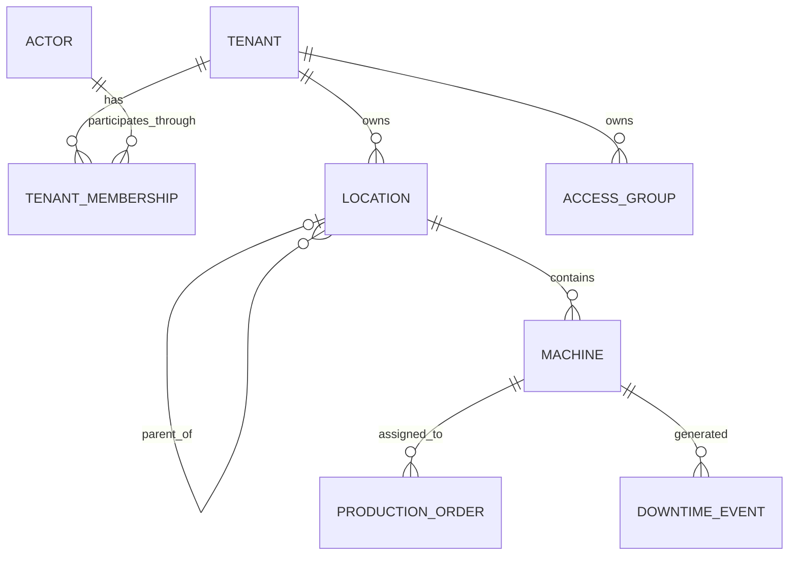

# SPEC-EP-00-F01 — Govern Scoped Access

## Identity and review state

| Field | Value |
| --- | --- |
| Source | [EP-00-F01 — Govern scoped access](../../product/epics/00-authorization-first-validation/01-govern-scoped-access.md), complete feature file |
| Supporting sources | [EP-00 overview](../../product/epics/00-authorization-first-validation/00-epic.md), [security/access requirements](../../product/requirements/00-andromeda-manufacturing-product-foundation/12-security-access-auditing-and-change-control.md), [operating model](../../product/requirements/00-andromeda-manufacturing-product-foundation/04-operating-model-and-master-data.md) |
| Context | [Authorization platform context](../00-authorization-platform-context.md) |
| Revision / date | **4** / 2026-10-28, America/Sao_Paulo |
| Approval / implementation | **Awaiting approval** / **not started**; no revision approved, no ADR, no implementation |

Revision 4 delegates authorization decisions to OpenFGA models, relations and conditions. Application bootstrap supplies only stable action/resource identifiers and their mappings; ordinary entity changes register the relevant facts/relationships. The reusable application mechanism asks the provider before execution and emits a structured log. There is no access-change-request product, approval workflow, transaction-callback gate, tenant lock/fence, graph snapshot/rebuild, reconciliation framework or audit database. The source's stronger concurrency/history requirements that this integration does not satisfy are identified below rather than claimed implemented.

## The proposed behavior, in plain language

A machine already has an ID and belongs to a tenant and a line in the application's database. A user already has an ID and a membership in that tenant. Giving that user permission to report good quantity on the machine creates an authorization relationship in OpenFGA. Putting the user in an authorized line group creates a different relationship. The application does not attach the whole factory hierarchy and every permission to the user row or send that universe with every request.

When A-OPERATOR tries to report good quantity on A-M1, the feature declares the action `quantities:good:report`. The selected identity supplies the actor and tenant; the request supplies the machine ID. The application verifies the ordinary records belong to that tenant and asks OpenFGA whether that actor has that action on that machine. OpenFGA uses the relationships **already stored there**, including group membership and hierarchy. Only a definite allow lets the inherited `execute` call the feature's `handle`.

A-OWNER may administer access without being allowed to report quantities. Membership in Tenant A is necessary but grants no manufacturing action on its own. Tenant B can have another machine whose readable code is also `M1`; its stable identity and authorization object are different.

F01 implements real access changes and labeled authorization probes for the later manufacturing operations. It does not post quantities, save setups, create orders or command equipment. Authentication, onboarding, unrestricted group editing, a role designer, public relocation and F02–F10 implementation remain excluded. The minimal records below are seeded platform records retained for later expansion; the old order/event records support AC07 without delivering their creation/production workflows.

## What exists, where it is stored and who uses it

| Thing | Example | Stored/defined where | Producer and consumer |
| --- | --- | --- | --- |
| Ordinary business record | Machine `m1a`, tenant `ta`, line `l1a` | Application PostgreSQL tables owned by the corresponding business module | Seeds now; later business usecases. Used to resolve real object identity, ownership and location. |
| User's tenant membership | User `u-operator` is active in `ta` | Application tenant-membership table; active membership also registered as an FGA tuple | Seeds/membership operation. Application supplies current status as a trusted fact and registers the active-member tuple; OpenFGA decides whether membership permits the operation. |
| Registered permission | `quantities:good:report` means report good quantity on a machine | Minimal application action vocabulary | Feature declares it; provider adapter maps it to `can_report_good`; provider model defines who may use/administer it. |
| Authorization model | `can_report_good` includes direct or inherited group sources and requires active membership | Versioned `.fga`/JSON artifact loaded into OpenFGA; private configured model ID | Trusted provider configuration defines authorization policy; deployment loads it, and adapters use the pinned model. Ordinary requests do not rewrite it. |
| Runtime authorization relationship | User belongs to group; group has a line grant; machine has current parent | OpenFGA tuples | Seed/authorized relationship Write. OpenFGA stores/traverses/evaluates them. |
| Check input | Actor + tenant + action + machine ID + trusted current time | One application call, then one provider request | Inherited application gate/provider adapter. No table of check inputs is needed. |
| Structured log | Actor, tenant, action, resource, allow/deny/unknown, time; grant source when relevant | Application's normal structured logging destination, not a new business entity/table | Application emits at operation boundaries. Useful operational evidence, not a permission source or full audit product. |

The database owns business truth: `TenantMembership.status`, `Location.parentLocationId`, `Machine.locationId`, and an old order/event's `machineId` and captured original location. OpenFGA stores the authorization-relevant edges corresponding to those facts. It does not own where a manufacturing machine really belongs. A seed or relevant business operation writes the corresponding edge when the fact is created/changed; a Check does not reload the entire hierarchy into OpenFGA.

Runtime permission grants, group membership sources, delegation ceilings and their evaluation rules are configured/stored in OpenFGA. The authorization capability exposes those operations through inward ports. Their SQL equivalents are not created. Fixed access-group names/IDs are small ordinary application records; their effective members and rights are FGA relationships. F01 has no general role entity/designer: an operator/group label is not a magic role granting every operation. The adjacent project's flat `roles` array is a useful action vocabulary reference, but cannot express these per-machine/line grants by itself.

### Representative application records

These are small readable **synthetic stable IDs**, not a recommendation to use display codes as identity. Real identifiers may be UUIDs. `A-M1` is the fixture label for machine ID `m1a`; its ordinary code is `M1`. Tenant B's code `M1` identifies `m1b`, not `m1a`.

| Application record | Representative stored fields |
| --- | --- |
| Tenant A / B | `{ id: "ta", code: "A" }` / `{ id: "tb", code: "B" }` |
| A-OPERATOR | `{ id: "u-operator", name: "A-OPERATOR", kind: "human", status: "active" }` |
| A-OWNER / A-DELEGATE / A-NONE | Actor IDs `u-owner`, `u-delegate`, `u-none`; names are fixture labels only |
| Active A memberships | `{ tenantId: "ta", actorId: "u-operator", status: "active" }`, similarly owner/delegate/none |
| DUAL | One actor ID `u-dual`; separate `{ tenantId: "ta", ... }` and `{ tenantId: "tb", ... }` membership rows |
| A hierarchy | Plant `p1a`; area `area1a.parentLocationId=p1a`; line `l1a.parentLocationId=area1a`; sibling line `l2a` |
| A-M1 / A-M2 | `{ id: "m1a", tenantId: "ta", code: "M1", locationId: "l1a" }`; machine `m2a` also belongs to `l1a` |
| B-M1 | `{ id: "m1b", tenantId: "tb", code: "M1", locationId: "l1b" }` |
| Old A order/event | Order `o-old-a` and event `e-old-a` retain `machineId: "m1a"`, `recordedLocationId: "l1a"` |
| A-L1-OPERATORS | `{ id: "g-l1a-operators", tenantId: "ta", name: "A-L1-OPERATORS" }` |



This diagram describes normal application records. Permission assignments and effective group members are in the FGA relationships below. An actor has no mandatory machine/line column: a person may receive several independent scoped grants. DUAL is why a global actor plus per-tenant membership is chosen instead of copying the reference project's single-tenant user shape unchanged.

## The OpenFGA model used by the example

The provider adapter maps an application resource to `resource:<tenant>/<kind>/<stable-id>`, an actor to `actor:<tenant>/<actor-id>`, and an action to a registered relation. Thus `m1a` is `resource:ta/machine/m1a`; `m1b` is `resource:tb/machine/m1b`. No browser payload chooses these strings, the store ID or model ID.

| Application action | OpenFGA relation on `resource` |
| --- | --- |
| `quantities:good:report` | `can_report_good` |
| `operations:summary:read` | `can_read_summary` |
| `setups:draft:save` | `can_save_setup_draft` |
| `quantities:scrap:report` / `orders:start` / `orders:approve` | `can_report_scrap` / `can_start_order` / `can_approve_order` |
| `access:grant` / `access:revoke` | `can_grant` / `can_revoke` |
| Add/remove access-group member | `can_manage_group_members` |
| Delegate/end administration / suspend tenant membership | `can_delegate_admin` / `can_suspend_membership` |
| Inspect current authorization relationships | `can_inspect` |

The provider model below is the authorization policy. A management authority is the FGA representation of one bounded delegation, not an application workflow/entity. Its stored condition context contains the permitted actions/operations/window. Resource inheritance supplies scope. The Check receives facts about the proposed change, and **OpenFGA**, not a TypeScript ceiling validator, compares them. A separate `enabled` relation controls grants already derived from that authority, so their execution-time checks need only current subject status/time, not management inputs.

The model also keeps source identities for independent removal. Application SQL does not copy this permission graph. This is a proposed deployable model, not an executed/accepted artifact; syntax and behavior are verified in the planned real-provider stage.

```fga
model
  schema 1.1

type actor

type action

type tenant
  relations
    define active_member: [actor]
    define current_status: [actor:* with subject_is_active]
    define current_member: active_member and current_status
    define access_owner: [actor]
    define owner: access_owner and current_member
    define owner_change_guard: [actor:* with owner_change]
    define authorized_owner_change: owner and owner_change_guard

type group
  relations
    define tenant: [tenant]
    define administration_scope: [resource]
    define member_source: [membership_source#effective]
    define member: member_source and current_member from tenant
    define child_group: [group]
    define contains_group: child_group or contains_group from child_group
    define self: [group]
    define all_groups: [group:*]
    define contains_or_self: self or contains_group
    define can_nest: all_groups but not contains_or_self
    define all_actors: [actor:*]
    define nonmember: all_actors but not member
    define can_receive_managed_access: (owner from tenant or nonmember) and current_member from tenant

type management_authority
  relations
    define tenant: [tenant]
    define change_actor: [actor with delegated_change]
    define can_change: change_actor and current_member from tenant
    define inspection_actor: [actor with delegated_inspection]
    define can_inspect: inspection_actor and current_member from tenant
    define enabled: [actor:* with within_window]

type membership_source
  relations
    define tenant: [tenant]
    define group: [group]
    define direct: [actor with within_window, group#member with within_window]
    define dependent: [actor with within_window, group#member with within_window]
    define authority: [management_authority]
    define eligible: direct or (dependent and enabled from authority)
    define effective: eligible and current_member from tenant

type grant
  relations
    define tenant: [tenant]
    define action: [action]
    define scope: [resource]
    define inheritable_scope: [resource]
    define direct: [actor with within_window, group#member with within_window]
    define dependent: [actor with within_window, group#member with within_window]
    define authority: [management_authority]
    define eligible: direct or (dependent and enabled from authority)
    define effective: eligible and current_member from tenant

type resource
  relations
    define tenant: [tenant]
    define parent: [resource]
    define ancestor: parent or ancestor from parent
    define owner: owner from tenant
    define owner_change: authorized_owner_change from tenant
    define exact_manager: [management_authority#can_change]
    define inheritable_manager: [management_authority#can_change]
    define inherited_manager: inheritable_manager or inherited_manager from parent
    define can_manage_changes: owner_change or exact_manager or inherited_manager
    define can_grant: can_manage_changes
    define can_revoke: can_manage_changes
    define can_manage_group_members: can_manage_changes
    define can_delegate_admin: owner_change
    define can_suspend_membership: owner_change
    define exact_inspector: [grant#effective, management_authority#can_inspect]
    define inheritable_inspector: [grant#effective, management_authority#can_inspect]
    define inherited_inspector: inheritable_inspector or inherited_inspector from parent
    define can_inspect: (owner or exact_inspector or inherited_inspector) and current_member from tenant
    define exact_good_reporter: [grant#effective]
    define inheritable_good_reporter: [grant#effective]
    define inherited_good_reporter: inheritable_good_reporter or inherited_good_reporter from parent
    define can_report_good: (exact_good_reporter or inherited_good_reporter) and current_member from tenant
    define exact_summary_reader: [grant#effective]
    define inheritable_summary_reader: [grant#effective]
    define inherited_summary_reader: inheritable_summary_reader or inherited_summary_reader from parent
    define can_read_summary: (exact_summary_reader or inherited_summary_reader) and current_member from tenant
    define exact_setup_drafter: [grant#effective]
    define inheritable_setup_drafter: [grant#effective]
    define inherited_setup_drafter: inheritable_setup_drafter or inherited_setup_drafter from parent
    define can_save_setup_draft: (exact_setup_drafter or inherited_setup_drafter) and current_member from tenant
    define exact_scrap_reporter: [grant#effective]
    define inheritable_scrap_reporter: [grant#effective]
    define inherited_scrap_reporter: inheritable_scrap_reporter or inherited_scrap_reporter from parent
    define can_report_scrap: (exact_scrap_reporter or inherited_scrap_reporter) and current_member from tenant
    define exact_order_starter: [grant#effective]
    define inheritable_order_starter: [grant#effective]
    define inherited_order_starter: inheritable_order_starter or inherited_order_starter from parent
    define can_start_order: (exact_order_starter or inherited_order_starter) and current_member from tenant
    define exact_order_approver: [grant#effective]
    define inheritable_order_approver: [grant#effective]
    define inherited_order_approver: inheritable_order_approver or inherited_order_approver from parent
    define can_approve_order: (exact_order_approver or inherited_order_approver) and current_member from tenant

condition subject_is_active(actor_status: string, membership_status: string) {
  actor_status == "active" && membership_status == "active"
}

condition within_window(now: timestamp, starts_at: timestamp, ends_at: timestamp) {
  now >= starts_at && now < ends_at
}

condition delegated_change(
  authority_id: string, authority_tenant: string,
  authority_from: timestamp, authority_until: timestamp,
  allowed_actions: list<string>, allowed_operations: list<string>, may_inherit: bool,
  selected_authority_id: string, actor_id: string, now: timestamp,
  operation: string, requested_actions: list<string>,
  recipient_kind: string, recipient_id: string, recipient_tenant: string, recipient_actor_status: string, recipient_membership_status: string,
  requested_from: timestamp, requested_until: timestamp, end_provided: bool,
  requested_inheritable: bool
) {
  selected_authority_id == authority_id &&
  now >= authority_from && now < authority_until &&
  operation in allowed_operations &&
  requested_actions.all(a, a in allowed_actions) &&
  (operation in ["add_member", "remove_member"] || size(requested_actions) > 0) &&
  (operation in ["revoke", "remove_member"] || (
    recipient_tenant == authority_tenant &&
    (recipient_kind == "group" || (recipient_actor_status == "active" && recipient_membership_status == "active")) &&
    (recipient_kind == "group" || recipient_id != actor_id) &&
    requested_from >= authority_from &&
    requested_from < (end_provided ? requested_until : authority_until) &&
    (!end_provided || requested_until <= authority_until) &&
    (!requested_inheritable || may_inherit)
  ))
}

condition delegated_inspection(
  authority_id: string, authority_from: timestamp, authority_until: timestamp,
  allowed_actions: list<string>, selected_authority_id: string,
  now: timestamp, requested_actions: list<string>
) {
  selected_authority_id == authority_id &&
  now >= authority_from && now < authority_until &&
  size(requested_actions) > 0 &&
  requested_actions.all(a, a in allowed_actions)
}

condition owner_change(
  owner_tenant: string, operational_actions: list<string>,
  selected_authority_id: string, operation: string, requested_actions: list<string>,
  recipient_kind: string, recipient_tenant: string, recipient_actor_status: string, recipient_membership_status: string,
  requested_from: timestamp, requested_until: timestamp
) {
  selected_authority_id == "owner" && recipient_tenant == owner_tenant &&
  operation in ["grant", "revoke", "add_member", "remove_member", "delegate", "revoke_delegation", "suspend_membership"] &&
  (operation in ["revoke", "remove_member", "revoke_delegation", "suspend_membership"] || (
    requested_actions.all(a, a in operational_actions) &&
    (operation == "add_member" || size(requested_actions) > 0) &&
    (recipient_kind == "group" || (recipient_actor_status == "active" && recipient_membership_status == "active")) &&
    requested_from < requested_until
  ))
}
```

The application's bootstrap catalog supplies only action/resource names and stable mappings. Ordinary machine/location/type constraints still belong to their business records. Which action inherits, who can administer it, the delegation ceiling, self-expansion restrictions and validity rules belong to this provider model/configuration. The adapter mechanically registers matching parent/source relations and invokes the corresponding policy query. Linked order/event access follows the machine's current FGA parent chain; the captured original location remains application history.

### Relationships already stored before A-OPERATOR's request

The seed writes these relationships using the same stable IDs as the application records. `W` below abbreviates the actual stored condition `within_window` with `starts_at=2026-10-28T00:00:00Z` and `ends_at=2026-10-29T00:00:00Z`. Tenant A also has `(actor:*, current_status, tenant:ta)` conditioned by `subject_is_active`, and `(actor:*, owner_change_guard, tenant:ta)` conditioned by `owner_change` with stored `owner_tenant="ta"` and the deployed operational-action list. Every resource has `(tenant:ta, tenant, resource:ta/...)`; a plant's parent is `resource:ta/tenant/ta`, an area's parent is its plant and a line's parent is its area.

| User | Relation | Object | Condition |
| --- | --- | --- | --- |
| `actor:ta/u-operator` | `active_member` | `tenant:ta` | — |
| `actor:ta/u-owner` | `active_member` / `access_owner` | `tenant:ta` | Two independent tuples |
| `tenant:ta` | `tenant` | `group:ta/g-l1a-operators` | — |
| `resource:ta/location/l1a` | `administration_scope` | `group:ta/g-l1a-operators` | Fixed group's ordinary management target |
| `group:ta/g-l1a-operators` | `self` | `group:ta/g-l1a-operators` | Cycle/self-nesting guard |
| `group:*` | `all_groups` | `group:ta/g-l1a-operators` | Candidate raw group subjects, no actor permission |
| `actor:*` | `all_actors` | `group:ta/g-l1a-operators` | Membership-based self-expansion guard |
| `resource:ta/location/l1a` | `parent` | `resource:ta/machine/m1a` | — |
| `resource:ta/location/l1a` | `parent` | `resource:ta/machine/m2a` | — |
| `resource:ta/machine/m1a` | `parent` | `resource:ta/production-order/o-old-a` | — |
| `resource:ta/machine/m1a` | `parent` | `resource:ta/downtime-event/e-old-a` | — |
| `tenant:ta` | `tenant` | `membership_source:ta/ms-operator-group` | — |
| `group:ta/g-l1a-operators` | `group` | `membership_source:ta/ms-operator-group` | — |
| `actor:ta/u-operator` | `direct` | `membership_source:ta/ms-operator-group` | W |
| `membership_source:ta/ms-operator-group#effective` | `member_source` | `group:ta/g-l1a-operators` | — |
| `tenant:ta` | `tenant` | `grant:ta/g-direct-m1` | — |
| `action:report_good` | `action` | `grant:ta/g-direct-m1` | — |
| `resource:ta/machine/m1a` | `scope` | `grant:ta/g-direct-m1` | Exact scope |
| `actor:ta/u-operator` | `direct` | `grant:ta/g-direct-m1` | W |
| `grant:ta/g-direct-m1#effective` | `exact_good_reporter` | `resource:ta/machine/m1a` | — |
| `tenant:ta` | `tenant` | `grant:ta/g-group-l1` | — |
| `action:report_good` | `action` | `grant:ta/g-group-l1` | — |
| `resource:ta/location/l1a` | `inheritable_scope` | `grant:ta/g-group-l1` | Descendant scope |
| `group:ta/g-l1a-operators#member` | `direct` | `grant:ta/g-group-l1` | W |
| `grant:ta/g-group-l1#effective` | `inheritable_good_reporter` | `resource:ta/location/l1a` | — |

For A-M1, OpenFGA can follow either `u-operator → direct grant → M1` or `u-operator → group membership → group line grant → current child machine`. For A-M2 only the group/line path exists. There is no rule saying a grant on A-M1 reaches its siblings or another tenant. Tenant B has its own membership/parent tuples and private store binding; its same readable code does not match these IDs.

### One real Check payload

The controlled validation context selects `{ actorId: "u-operator", tenantId: "ta" }`. A good-quantity probe receives `{ machineId: "m1a" }`; the **feature**, not the body, declares `quantities:good:report`. The application resolves the real actor, membership and machine records. Same-tenant record lookup is a data-integrity boundary. It supplies the observed current actor and membership status values as trusted strings; the OpenFGA `subject_is_active` condition, not a local permission rule, decides whether that status allows access. The neutral provider receives:

```json
{
  "actorId": "u-operator",
  "tenantId": "ta",
  "action": "quantities:good:report",
  "resource": { "kind": "machine", "id": "m1a" },
  "evaluatedAt": "2026-10-28T13:00:00Z",
  "actorStatus": "active",
  "membershipStatus": "active"
}
```

The adapter's native OpenFGA Check body is:

```json
{
  "tuple_key": {
    "user": "actor:ta/u-operator",
    "relation": "can_report_good",
    "object": "resource:ta/machine/m1a"
  },
  "authorization_model_id": "01GXSA8YR785C4FYS3C0RTG7B1",
  "context": { "now": "2026-10-28T13:00:00Z", "actor_status": "active", "membership_status": "active" },
  "consistency": "HIGHER_CONSISTENCY"
}
```

The model ID is an example of the adapter's configured pinned ID, not an existing deployment. The store ID is in the provider URL/configuration, not in the actor's request. This Check returns `{ "allowed": true }` for the example. The adapter maps it to a neutral `allowed` result; the base then calls `handle`. `{ "allowed": false }` produces denial and no `handle`. A timeout, invalid response or unavailable provider produces `indeterminate` and no `handle`; it is not converted to a normal deny or reused positive answer.

No user locations, groups, roles or permission list are sent with that Check. Those relationships were written earlier. `now` is trusted server time so the caller cannot extend an expired grant. Every new operation calls Check again. The exact start is inclusive and end exclusive in the model; an invocation evaluated before expiry may finish afterward. Strict completion-before-expiry is not promised by this simple check-then-handle flow.

### Delegated changes are decided by FGA before Write

A-DELEGATE's authority is stored as `management_authority:ta/d-line1`. Relevant seed tuples are:

| User | Relation | Object | Stored condition/context |
| --- | --- | --- | --- |
| `tenant:ta` | `tenant` | `management_authority:ta/d-line1` | — |
| `actor:ta/u-delegate` | `change_actor` | `management_authority:ta/d-line1` | `delegated_change`, parameters below |
| `actor:ta/u-delegate` | `inspection_actor` | `management_authority:ta/d-line1` | `delegated_inspection` with same ID/action/window bounds |
| `actor:*` | `enabled` | `management_authority:ta/d-line1` | `within_window`, 08:00 inclusive to 18:00 exclusive |
| `management_authority:ta/d-line1#can_change` | `inheritable_manager` | `resource:ta/location/l1a` | Scope comes from this relation, not a caller assertion |
| `management_authority:ta/d-line1#can_inspect` | `inheritable_inspector` | `resource:ta/location/l1a` | Scoped inspection only |

The `change_actor` tuple's **persisted** condition context is:

```json
{
  "authority_id": "d-line1",
  "authority_tenant": "ta",
  "authority_from": "2026-10-28T08:00:00Z",
  "authority_until": "2026-10-28T18:00:00Z",
  "allowed_actions": ["operations:summary:read", "setups:draft:save", "quantities:good:report"],
  "allowed_operations": ["grant", "revoke", "add_member", "remove_member"],
  "may_inherit": true
}
```

For the proposed exact M2 grant to A-NONE, the native Check is:

```json
{
  "tuple_key": {
    "user": "actor:ta/u-delegate",
    "relation": "can_manage_changes",
    "object": "resource:ta/machine/m2a"
  },
  "authorization_model_id": "01GXSA8YR785C4FYS3C0RTG7B1",
  "context": {
    "selected_authority_id": "d-line1",
    "actor_id": "u-delegate",
    "actor_status": "active",
    "membership_status": "active",
    "now": "2026-10-28T13:00:00Z",
    "operation": "grant",
    "requested_actions": ["quantities:good:report"],
    "recipient_kind": "actor",
    "recipient_id": "u-none",
    "recipient_tenant": "ta",
    "recipient_actor_status": "active",
    "recipient_membership_status": "active",
    "requested_from": "2026-10-28T13:00:00Z",
    "requested_until": "2026-10-28T18:00:00Z",
    "end_provided": true,
    "requested_inheritable": false
  },
  "consistency": "HIGHER_CONSISTENCY"
}
```

| Change to that proposed Check | FGA result and reason |
| --- | --- |
| Exact request above | `allowed: true`; L1 inheritance reaches M2 and the CEL condition passes |
| `requested_actions=["orders:approve"]` | False; action absent from the tuple's stored allowed list |
| Target `resource:ta/location/p1a` or sibling `.../l2a` | False; neither is a descendant covered by the L1 authority |
| Explicit end at 19:00 | False; condition rejects an extension beyond 18:00 |
| Actor recipient `u-delegate` | False; condition rejects self-expansion |
| Recipient tenant `tb`, or inactive actor recipient | False; provider condition rejects those facts |
| `operation="delegate"` or relation `can_delegate_admin` | False; delegated operations exclude onward delegation and that relation is owner-only |
| Caller actor or membership status replaced with `"inactive"` / `"suspended"` | False; provider membership/status intersection fails |

The application does not perform those comparisons after a broad allow. It builds the trusted facts, asks this FGA query and writes only when the complete provider result allows. Stored context takes precedence over conflicting request context in OpenFGA; the API accepts neither policy lists nor authority bounds from a caller.

The selected authority is also bound in the condition. The adapter enumerates direct `change_actor` records for the acting actor (paged Read), and asks the resource policy with one candidate ID at a time, or an owner candidate `selected_authority_id="owner"`. A candidate is usable only when the required FGA queries for the operation all allow **that same candidate**. The resulting private authority reference is carried to the focused Write adapter; a different delegation cannot authorize the Check and govern the created grant. This is ordinary provider adaptation, not a local role/ceiling decision or reusable client permit.

For revoke/remove, action/scope/recipient facts come from the existing stored source, not the body. The condition checks current administrative scope/action authority but deliberately does not require the old recipient to be active or the removed source window to be current. An active authorized administrator can clean up expired/inactive sources. If the administrator's own delegation expired, its management authority is gone; the owner can still perform cleanup.

When the caller omits an end, the adapter supplies `end_provided=false` and a documented upper-bound timestamp. FGA may allow that omission, but a dependent source still intersects the authority's `enabled` window at execution time. An explicit longer end is refused by the condition. The application does not calculate/clamp the effective ceiling.

### One grant and two removals

For AC01, A-DELEGATE requests a good-report grant to A-NONE on A-M2. The input is an ordinary operation input, not an approval/change-request entity:

```json
{
  "recipient": { "kind": "actor", "id": "u-none" },
  "action": "quantities:good:report",
  "scope": { "kind": "machine", "id": "m2a" },
  "includesDescendants": false,
  "startsAt": "2026-10-28T13:00:00Z",
  "endsAt": "2026-10-28T18:00:00Z",
  "reason": "Assign the afternoon reporting responsibility"
}
```

The acting identity remains `u-delegate`, not the recipient `u-none`. The provider Check above decides the entire proposed action/scope/window/recipient restriction using the stored `d-line1` authority. The same normalized facts and specifically allowed authority reference are used for the Write; neither a local ceiling check nor a caller-supplied authority assertion is used. A-DELEGATE's administration source does not place it in any reporting relation.

Assuming an active A-NONE membership and that current delegation, the adapter generates stable grant ID `g-none-m2` and issues this native Write in one transaction:

```json
{
  "writes": {
    "tuple_keys": [
      { "user": "tenant:ta", "relation": "tenant", "object": "grant:ta/g-none-m2" },
      { "user": "action:report_good", "relation": "action", "object": "grant:ta/g-none-m2" },
      { "user": "resource:ta/machine/m2a", "relation": "scope", "object": "grant:ta/g-none-m2" },
      { "user": "management_authority:ta/d-line1", "relation": "authority", "object": "grant:ta/g-none-m2" },
      {
        "user": "actor:ta/u-none", "relation": "dependent", "object": "grant:ta/g-none-m2",
        "condition": {
          "name": "within_window",
          "context": { "starts_at": "2026-10-28T13:00:00Z", "ends_at": "2026-10-28T18:00:00Z" }
        }
      },
      { "user": "grant:ta/g-none-m2#effective", "relation": "exact_good_reporter", "object": "resource:ta/machine/m2a" }
    ]
  },
  "authorization_model_id": "01GXSA8YR785C4FYS3C0RTG7B1"
}
```

The `d-line1` authority and its conditional management/inspection/enable tuples are shown above; its `can_change` userset is attached to A-L1's `inheritable_manager`. The wildcard only gates an already identified recipient/delegate; it does not grant anyone an operation by itself. The source grant is effective only while both windows and the recipient's active membership hold. The shown Write grants M2 only; no start/scrap/approval/source on other machines was written.

For AC03, A-OWNER instead revokes the existing **direct** A-OPERATOR source `g-direct-m1`. After the same management policy allows `operation="revoke"` using the stored source facts, the adapter deletes its recipient edge:

```json
{
  "deletes": {
    "tuple_keys": [
      { "user": "actor:ta/u-operator", "relation": "direct", "object": "grant:ta/g-direct-m1" }
    ]
  },
  "authorization_model_id": "01GXSA8YR785C4FYS3C0RTG7B1"
}
```

A fresh A-M1 Check still returns true through the group. A second authorized removal deletes `(actor:ta/u-operator, direct, membership_source:ta/ms-operator-group)`. With no other source, a fresh Check returns false. Removing source metadata is not needed to remove its authority; a source without an effective recipient contributes nothing. A structured log records which source was removed and the fresh decision result; Check itself does not return the full explanatory path shown in this worked example.

## Application flow and replaceable adapter

Retain the actual adjacent [AuthorizedUsecase reference](/home/ninho/projects/andromeda-platform/apps/andromeda-backend/src/modules/@shared/auth/authorized-usecase.ts) mechanism: base-owned `execute(input, identity)` checks authority before `handle(input, identity)`. Its static role-overlap implementation is replaced by an injected authorization capability; it is not copied as a resource policy. A forwarding-only additional authorization-usecase layer is unnecessary.

```mermaid
sequenceDiagram
    participant I as Inbound adapter
    participant B as Inherited execute
    participant A as Application authorization capability
    participant P as OpenFGA outbound adapter
    participant F as OpenFGA
    participant H as Feature handle
    I->>B: input and selected actor/tenant
    B->>A: declared action and target identity
    A->>A: resolve trusted identity, entity and current status facts
    A->>P: declared action plus trusted facts/proposed change
    P->>F: native policy Check(s) using stored relationships and conditions
    F-->>P: allowed boolean or provider failure
    P-->>A: allowed / denied / indeterminate
    A-->>B: result and private authority reference if needed; log
    alt allowed
        B->>H: handle input only after allow; carry checked authority for a change
    else denied or indeterminate
        B-->>I: safe refusal; handle never called
    end
```

The authorization capability supplies registered names and trusted identity/entity facts, invokes provider decisions and translates/logs the result. It does not compare authorization ceilings or evaluate effective permissions. The private result may identify the specifically allowed authority for the same relationship change; it is not exposed to clients or reusable for another input. There is no transaction around a callback. The base is responsible for invoking it, then calling `handle` only on allow. Private/read-only record resolution before the Check returns no protected contents to the caller. Ordinary business invariants remain in the relevant feature. Authorization conditions that OpenFGA can evaluate stay in its provider model.

For a relationship-management usecase, inherited `execute` passes that private decision alongside input/identity to `handle`; ordinary features need only input/identity. The focused writer receives the same normalized operation and `authorityReference` selected by its policy Check. It neither chooses a different authority nor accepts one from an HTTP body. A missing reference for a management allow is an invalid provider result and prevents Write. This small internal data handoff does not introduce a permit service, callback transaction or additional policy layer.

`modules/@shared/auth` defines the authorized base/neutral identity contract. Authorization application declares provider interfaces. Business-aware mapping/model belongs in authorization `features/authorize/outbound/openfga`; focused grant/revoke/group/delegation adapters are in their operation's outbound edge. Generic SDK/client/configuration stays in `platform/openfga` and imports no business modules. Wire composes these. The adjacent [IdentityProviderInterface](/home/ninho/projects/andromeda-platform/apps/andromeda-backend/src/modules/account/features/create-account/application/interfaces.ts) and [Keycloak adapter](/home/ninho/projects/andromeda-platform/apps/andromeda-backend/src/modules/account/features/create-account/outbound/identity/keycloak-identity-provider.ts) illustrate this boundary; no adjacent code is changed or assumed present here.

Provider-specific model/store IDs, tuples, relation names, consistency flags and errors do not leak into feature inputs. Human/service/agent principals use the same contract. Middleware selects/authenticates an identity but does not decide operation permission. Validation mode uses seeded identities only; authentication/Keycloak integration and a production selector are excluded.

## Complete commented business-record contracts

These are proposed minimal records and intended paths, not implemented modules. All paths below are relative to `apps/andromeda-backend/src/`. Comments explain purpose/storage and significant fields as explicitly requested. Fields are ordinary application facts, not FGA-native objects. Pure contracts contain no methods, ORM annotations or I/O; database mappings remain at the outer edge.

Intended path: `modules/tenant/entity/tenant.entity.ts`.

```ts
/** One customer organization. Persisted in the application's tenants table. */
export interface TenantEntityInterface {
  /** Stable customer ID, such as "ta"; scopes every tenant-owned record. */
  id: string;
  /** Human-readable seed/customer code, such as "A"; never an authorization ID. */
  code: string;
}
```

Intended path: `modules/identity/entity/actor.entity.ts`.

```ts
export const ACTOR_KIND = { HUMAN: "human", SERVICE: "service", AGENT: "agent" } as const;
export type ActorKind = (typeof ACTOR_KIND)[keyof typeof ACTOR_KIND];
export const ACTOR_STATUS = { ACTIVE: "active", INACTIVE: "inactive" } as const;
export type ActorStatus = (typeof ACTOR_STATUS)[keyof typeof ACTOR_STATUS];

/** Stable platform identity, persisted in actors; contains no login credentials or permissions. */
export interface ActorEntityInterface {
  /** Identifies the person/service/agent, such as "u-operator"; DUAL has one such ID. */
  id: string;
  /** Display/fixture name; does not grant a role, tenant membership or operation. */
  name: string;
  /** Distinguishes a human from an accountable service/agent identity. */
  kind: ActorKind;
  /** Ordinary lifecycle fact. The application supplies it to FGA; inactive never means a local role rule. */
  status: ActorStatus;
  /** Required by domain validation for service/agent identities; absent for ordinary humans. */
  ownerActorId?: string;
}
```

Intended path: `modules/tenant/entity/tenant-membership.entity.ts`.

```ts
export const MEMBERSHIP_STATUS = { ACTIVE: "active", SUSPENDED: "suspended", REMOVED: "removed" } as const;
export type MembershipStatus = (typeof MEMBERSHIP_STATUS)[keyof typeof MEMBERSHIP_STATUS];

/** One actor's participation in one tenant; persisted under a unique tenantId/actorId key. */
export interface TenantMembershipEntityInterface {
  /** Customer this membership belongs to; changing A never changes the independent B row. */
  tenantId: string;
  /** Foreign key to the global actor, such as "u-dual". */
  actorId: string;
  /** Ordinary membership state; active is registered as tenant#active_member and supplied as a trusted FGA status fact. */
  status: MembershipStatus;
}
```

Intended path: `modules/location/entity/location.entity.ts`.

```ts
export const LOCATION_KIND = { PLANT: "plant", AREA: "area", LINE: "line", WAREHOUSE: "warehouse" } as const;
export type LocationKind = (typeof LOCATION_KIND)[keyof typeof LOCATION_KIND];

/** Actual factory/logistics location, persisted in locations; application owns this hierarchy. */
export interface LocationEntityInterface {
  /** Stable location ID, such as "l1a"; distinct from another tenant's readable L1 code. */
  id: string;
  /** Required tenant ownership; every parent lookup uses the same tenant. */
  tenantId: string;
  /** Readable identifier, such as "L1". */
  code: string;
  /** Determines valid parent kinds; warehouses cannot become line descendants. */
  kind: LocationKind;
  /** Current parent location. Absent for a root plant; its FGA parent is the tenant root. */
  parentLocationId?: string;
}
```

Intended path: `modules/machine/entity/machine.entity.ts`.

```ts
/** Minimal real machine record, persisted in machines; later features add machine details. */
export interface MachineEntityInterface {
  /** Stable identity, such as "m1a"; survives a line reassignment. */
  id: string;
  /** Required customer ownership; a foreign machine is never resolved by code alone. */
  tenantId: string;
  /** Readable machine code; both A and B may legitimately store "M1". */
  code: string;
  /** Current application location, such as "l1a"; represented as a parent edge in FGA. */
  locationId: string;
}
```

Intended path: `modules/production-order/entity/production-order.entity.ts`.

```ts
/** Minimal seeded order record for the F01 old-record access scenario, not an order-creation flow. */
export interface ProductionOrderEntityInterface {
  /** Stable order identity, such as "o-old-a". */
  id: string;
  /** Required owner tenant. */
  tenantId: string;
  /** Readable order code for authorized display. */
  code: string;
  /** Stable assigned machine; current read inheritance follows that machine's current location. */
  machineId: string;
  /** Original location captured as history; never used to grant current access. */
  recordedLocationId: string;
}
```

Intended path: `modules/downtime/entity/downtime-event.entity.ts`.

```ts
/** Minimal seeded machine event used by AC07; event ingestion/classification is not delivered here. */
export interface DowntimeEventEntityInterface {
  /** Stable event identity, such as "e-old-a". */
  id: string;
  /** Required owner tenant. */
  tenantId: string;
  /** Originating stable machine; FGA links this event to that machine. */
  machineId: string;
  /** Original location remains history when the machine moves. */
  recordedLocationId: string;
  /** Event occurrence in UTC; describes business history, not authorization evaluation time. */
  occurredAt: string;
}
```

Intended path: `modules/authorization/entity/access-group.entity.ts`.

```ts
/** Fixed access-group identity/name in access_groups; members and grants are FGA relationships. */
export interface AccessGroupEntityInterface {
  /** Stable group ID, such as "g-l1a-operators"; identifies its FGA group object. */
  id: string;
  /** Tenant that owns the group; a B actor/group cannot be added through an A operation. */
  tenantId: string;
  /** Display name, such as "A-L1-OPERATORS"; its name grants no permission by itself. */
  name: string;
}
```

These records deliberately omit unrelated onboarding, machine telemetry, full order lifecycle and production-accounting fields. IDs/foreign keys are strings and tenant-owned joins require the tenant; group/grant expansion is not performed by SQL. No existing entity contract is replaced because this repository currently has no source implementation. Future feature specs evolve these retained records rather than discarding their identities/authority.

## Catalog, Check input and ordinary grant input

A permission identifier is the registered **meaning of an action**, not a permission already held by a user. The catalog lives in application code/configuration, maps to provider relations as shown above; authorization meaning/conditions live in the versioned provider model, not a TypeScript policy engine. A generic reference parameter is just an address of a real record; it is not a new `AuthorizationResource` table.

Intended path: `modules/authorization/entity/authorization.types.ts`.

```ts
/** Registered platform operations; holding one still requires an FGA relationship on a scope. */
export const ACCESS_ACTION = {
  GRANT: "access:grant", REVOKE: "access:revoke",
  ADD_GROUP_MEMBER: "access:group-member:add", REMOVE_GROUP_MEMBER: "access:group-member:remove",
  DELEGATE: "access:delegate", REVOKE_DELEGATION: "access:delegation:revoke",
  SET_MEMBERSHIP: "access:membership:set-status", INSPECT: "access:evidence:read",
  READ_SUMMARY: "operations:summary:read", SAVE_SETUP_DRAFT: "setups:draft:save",
  REPORT_GOOD: "quantities:good:report", REPORT_SCRAP: "quantities:scrap:report",
  START_ORDER: "orders:start", APPROVE_ORDER: "orders:approve"
} as const;
export type AccessAction = (typeof ACCESS_ACTION)[keyof typeof ACCESS_ACTION];

/** Addresses actual tenant/location/machine/order/event records; not a separate stored entity. */
export const RESOURCE_KIND = {
  TENANT: "tenant", LOCATION: "location", MACHINE: "machine",
  PRODUCTION_ORDER: "production-order", DOWNTIME_EVENT: "downtime-event"
} as const;
export type ResourceKind = (typeof RESOURCE_KIND)[keyof typeof RESOURCE_KIND];
```

Intended path: `modules/authorization/entity/authorization.references.ts`.

```ts
import type { ResourceKind } from "./authorization.types";

/** Address of one existing business record; callers do not provide its tenant/hierarchy as authority. */
export interface ResourceReferenceInterface {
  /** Chooses the registered reader/model mapping, such as "machine". */
  kind: ResourceKind;
  /** Actual stable ID, such as "m1a"; resolved in the selected tenant. */
  id: string;
}

/** Recipient of a grant; differs from the actor performing the administration operation. */
export interface PermissionRecipientInterface {
  /** An individual actor or the effective members of one fixed access group. */
  kind: "actor" | "group";
  /** Existing actor/group ID, such as "u-none" or "g-l1a-operators". */
  id: string;
}
```

Intended path: `modules/authorization/features/authorize/application/interfaces.ts`.

```ts
import type { AccessAction } from "modules/authorization/entity/authorization.types";
import type { ResourceReferenceInterface } from "modules/authorization/entity/authorization.references";

/** Facts of one proposed relationship operation; input to FGA policy, never an approval/entity. */
export interface PermissionManagementFactsInterface {
  /** Server-selected operation determines which provider policy applies, not a caller override. */
  operation: "grant" | "revoke" | "add_member" | "remove_member" | "delegate" | "revoke_delegation" | "suspend_membership";
  /** Proposed action(s), or existing source actions for cleanup/group changes; no allowed-action list. */
  actions: readonly AccessAction[];
  /** Actual referenced actor/group, resolved from existing records or stored source facts. */
  recipient: { kind: "actor" | "group"; id: string };
  /** Actor's target membership tenant, or group's owning tenant; an absent actor membership is reported separately. */
  recipientTenantId: string;
  /** Observed lifecycle status, not a computed permission; group recipients use "not-applicable". */
  recipientActorStatus: "active" | "inactive" | "not-applicable";
  /** Observed selected-tenant membership status; FGA decides whether the operation requires active. */
  recipientMembershipStatus: "active" | "suspended" | "removed" | "absent" | "not-applicable";
  /** Normalized requested start, or retained source start for cleanup. */
  startsAt: string;
  /** Requested exclusive end; omitted end is handled by provider policy, not local clamping. */
  endsAt?: string;
  /** Requested/retained inheritance flag; FGA compares it with the configured authority. */
  includesDescendants: boolean;
}

/** One current operation check, built by the application; transient, not a database entity. */
export interface AuthorizationCheckInputInterface {
  /** Acting user/service/agent from selected identity, never replaced by a recipient in the body. */
  actorId: string;
  /** Selected active tenant context; does not combine a user's independent memberships. */
  tenantId: string;
  /** Registered operation declared by the feature, such as "quantities:good:report". */
  action: AccessAction;
  /** Specific object being acted on, such as machine m1a. */
  resource: ResourceReferenceInterface;
  /** Trusted UTC instant used for FGA conditions; not supplied by the caller. */
  evaluatedAt: string;
  /** Current ordinary actor status copied from its record; the model evaluates it. */
  actorStatus: "active" | "inactive";
  /** Current selected-tenant participation status; no membership is represented as "absent". */
  membershipStatus: "active" | "suspended" | "removed" | "absent";
  /** Present for access changes so FGA can authorize the full proposal before Write. */
  management?: PermissionManagementFactsInterface;
  /** Requested operational action(s) for scoped current-source inspection, not the actor's roles. */
  inspectedActions?: readonly AccessAction[];
}

/** Provider-neutral result. An unavailable/invalid provider response is not a definite denial. */
export interface AuthorizationCheckResultInterface {
  /** Only "allowed" permits the base to call handle. */
  outcome: "allowed" | "denied" | "indeterminate";
  /** Private provider-selected authority proven for this exact change; absent for ordinary checks. */
  authorityReference?: string;
}

/** Replaceable relationship evaluator; concrete OpenFGA adapter owns SDK/store/model details. */
export interface AuthorizationProviderInterface {
  /** Checks relationships already stored by earlier registration/access-management operations. */
  check(input: AuthorizationCheckInputInterface): Promise<AuthorizationCheckResultInterface>;
}
```

Intended path: `modules/authorization/features/grant/domain/types.ts`.

```ts
import type { AccessAction } from "modules/authorization/entity/authorization.types";
import type {
  PermissionRecipientInterface, ResourceReferenceInterface
} from "modules/authorization/entity/authorization.references";

/** Ordinary input to grant one operational action; not an approval or change-request record. */
export interface GrantPermissionInputInterface {
  /** Who will receive the action, such as A-NONE; the initiator comes from selected identity. */
  recipient: PermissionRecipientInterface;
  /** Proposed operational action; FGA's management policy rejects administrative actions in this grant operation. */
  action: AccessAction;
  /** Where the grant applies: e.g. exact machine m2a or a line for downward inheritance. */
  scope: ResourceReferenceInterface;
  /** True uses an inheritable FGA source; false never grants siblings/children by itself. */
  includesDescendants: boolean;
  /** Inclusive UTC start; when absent, the application uses its trusted current time. */
  startsAt?: string;
  /** Exclusive UTC end; absent means no end only when the initiator's authority permits that. */
  endsAt?: string;
  /** Business explanation copied to the structured log; not an authorization-rule override. */
  reason: string;
}
```

Other focused operations remain ordinary inputs, not additional domain entities: revoke receives a grant ID and reason; remove-group-member receives a membership-source ID and reason; add-group-member receives an existing group and actor/group member plus optional window/reason; delegate receives the administrator, allowed actions, scope/inheritance and window; end-delegation receives its ID; suspend/remove membership identifies the tenant membership. Acting identity always comes separately from `execute`. IDs of newly created grant/membership/delegation sources are generated by the application/adapter and returned so a later operation can remove that exact source.

## Minimal bootstrap, trusted facts and provider decisions

| Responsibility | Kept in the application/integration | Decided in OpenFGA |
| --- | --- | --- |
| Names/input | Declare the invoked action, real resource kinds, stable IDs and request schema | Relation mapping/model determines who may perform the operation |
| Identity/entity facts | Resolve selected actor/tenant, membership status, actual recipient/resource and source records; timestamps and normalized requested values | Conditions use these facts; no local role/action/scope/window comparison |
| Administrative grant | Pass proposed action(s), actual recipient, target scope, requested validity/inheritance | Stored policy compares action list, current authority/window, self and tenant restrictions; graph resolves scope |
| Existing grant/group removal | Read current source/action/scope/recipient metadata and ask the cleanup operation policy | Current management authority permits/refuses cleanup; old source expiry/inactivity does not block an otherwise valid removal |
| Group/nested-group change | Read current affected source metadata and compose explicit provider queries | FGA evaluates containing-group reachability, self-expansion, cycle guard and each affected scope/action permission |
| Write | Mechanically map the unchanged allowed input/authority into one provider Write; log known result | Write validates/persists tuples but does **not** authorize the initiating platform actor |
| Entity lifecycle | Persist ordinary membership/machine facts; invoke the relevant outbound relationship update | Active-member gates and current parent relationships determine resulting authority |

Only irreducible data-integrity checks remain local: valid identity/input shape, referenced records really exist, IDs/foreign keys belong to the selected tenant, allowed ordinary parent **entity types**, valid timestamp encoding and correspondence between the checked input and tuple being written. These do not decide a user's permission. There is no local effective-grant calculation, scope-walking authorization engine, allowed-action subset function or delegation time clamp.

For group-mediated self-expansion, the adapter also asks the recipient/nested group's `can_receive_managed_access` with the acting actor. FGA excludes a delegated administrator who is already a member of that recipient group; its owner branch supports separately authorized owner administration. Each seeded group has `self` and wildcard `all_groups` relations. To make **OUTER contain INNER**, Check user `group:OUTER`, relation `can_nest`, object `group:INNER`. FGA refuses when INNER already contains OUTER, or they are the same group. Example: existing G contains N; proposed N contains G is refused by Check user `group:N`, relation `can_nest`, object `group:G`. Raw group and actor subjects are distinct types. Required queries are combined as **all provider results must allow**, not by locally traversing memberships or evaluating a ceiling.

An unrelated pair permits the structural query, self-nesting denies, and the inverse of an existing containment denies. Repeating the existing same-direction containment is not a cycle and permits that structural query; distinct membership-source objects remain independently removable. Any repeated structural marker tuple is handled using the provider's identical-write conflict option, not by treating a duplicate as an authorization refusal. Delete the marker only when its last source is removed. These are representation/integrity operations on returned source records, not a second reachability evaluator.

For a membership addition, the resulting rights include current grants of the target and its containing groups. Candidate group IDs come from the small ordinary group registry; FGA Check/BatchCheck `contains_group` identifies the containing groups, and paged source Reads return their current action/scope metadata. The adapter supplies those facts to `can_manage_changes` checks on every affected scope, using the **same** selected authority and proposed membership window. A broader action or plant/sibling scope is refused by the FGA condition/graph. Empty groups use their configured FGA administration scope; no new right is inferred from an empty list. Standard capped ListObjects output cannot prove complete absence. An incomplete/error query refuses the change.

This supports the bounded sequential F01 groups, including its fixed nested variant. FGA CEL cannot make graph queries or universally quantify an arbitrary future graph inside a condition. It does not automatically evaluate hypothetical writes, maintain group-wide policy invariants under concurrent unrelated changes or atomically combine these Checks with Write. Those unsupported global/prospective guarantees are not replaced by TypeScript policy or a new framework; they remain limits of the simple integration.

A delegate-created direct or membership source references the same management authority actually allowed for the change and uses `dependent`, never `direct`. Ending that authority deletes its `enabled` gate and management/inspection actor edges; dependent execution paths cease without enumerating recipients. An independent owner source remains independent. A-OWNER's `access_owner` and owner-change condition authorize administration only; no operational relation derives from them.

### Grant, revoke, deactivation and ordinary entity updates

- **Grant/revoke:** prepare facts, obtain the full provider allow, then call the focused outbound Write as demonstrated. The service's OpenFGA credential executes the Write; it is not the platform actor's identity and supplies no business authorization itself.
- **Tenant membership suspension/removal:** ask `can_suspend_membership` through the owner-change policy using actual target membership facts; persist that tenant membership status and delete `(actor:ta/u-dual, active_member, tenant:ta)` via outbound API. DUAL's B membership/tuples are untouched. Existing grant nodes may remain as inert provenance; they cannot bypass `current_member`.
- **Ordinary invocation after suspension:** supply the actual inactive actor or suspended/removed membership status. `subject_is_active` makes OpenFGA deny even if a failed tuple-cleanup attempt left old membership data. The application forwards the fact instead of implementing a local permission rule.
- **Machine/location or other relevant entity changes:** ordinary records own their hierarchy. The entity operation registers/deletes matching FGA parent edges through outbound API. AC07's old order/event keeps its original location and stable machine ID. No complete user/world graph is resubmitted on Check.

The tenant-local native deletion is simply:

```json
{
  "deletes": {
    "tuple_keys": [
      { "user": "actor:ta/u-dual", "relation": "active_member", "object": "tenant:ta" }
    ]
  },
  "authorization_model_id": "01GXSA8YR785C4FYS3C0RTG7B1"
}
```

Global actor inactivation is a different lifecycle event: current actor status is supplied as `"inactive"` in every selected tenant, and the lifecycle owner propagates removal to its affected FGA memberships. It must not be confused with suspending one membership. F01 exercises tenant suspension/removal; it does not implement identity-provider account lifecycle.

The adjacent Keycloak semantic adapter/port/wire was reread on 2026-10-28. It demonstrates an inward application interface over outbound translation and generic platform services; its user creation currently uses `enabled:true`. No implemented deactivate/suspend method was found in that reference inventory. Do not claim one exists or copy authentication into F01. A future **global** account-lifecycle requirement may call a Keycloak disable API through its own outbound port; tenant-local DUAL suspension must never globally disable that shared account. The FGA update is required here; a Keycloak update is conditional on the actual identity lifecycle, not a second permission engine.

## Structured logging as supporting information

The requester explicitly retained a well-structured log. F01 BR06 is the source of actor/recipient/source/action/scope/time/reason attribution. Logging is supporting information, not the authorization engine, a new business workflow or an audit-query database. Emit one check result and a management-operation result where known. Provider failures use safe categories; never log credentials, tokens, private provider responses or foreign business contents.

For the acknowledged grant shown above, an event can be this simple:

```json
{
  "event": "authorization.grant",
  "actorId": "u-delegate",
  "tenantId": "ta",
  "action": "quantities:good:report",
  "scope": { "kind": "machine", "id": "m2a" },
  "recipient": { "kind": "actor", "id": "u-none" },
  "sourceId": "g-none-m2",
  "result": "applied",
  "occurredAt": "2026-10-28T13:00:01Z",
  "reason": "Assign the afternoon reporting responsibility",
  "policyVersion": "authorization-v1",
  "scenarioVersion": "ep00-v1"
}
```

This records who gave which action to whom and where. It is a logger call after a known operation outcome, not another request object to approve or process.

Intended path: `modules/authorization/features/authorize/application/authorization-log.interface.ts`.

```ts
import type { AccessAction } from "modules/authorization/entity/authorization.types";
import type {
  PermissionRecipientInterface, ResourceReferenceInterface
} from "modules/authorization/entity/authorization.references";

/** Structured event sent to the application's logger; not persisted as a new domain entity. */
export interface AuthorizationLogEntryInterface {
  /** Distinguishes a check from an actual grant/revoke/group/delegation/membership operation. */
  event: string;
  /** Initiating actor from selected identity; for a grant this is the administrator, not recipient. */
  actorId: string;
  /** Tenant boundary of the attempt. Log access must not expose another tenant's entries. */
  tenantId: string;
  /** The registered action checked or administered, when that operation has one action. */
  action?: AccessAction;
  /** Object of a normal check, such as the actual machine m1a. */
  resource?: ResourceReferenceInterface;
  /** Boundary of a management operation, such as line l1a for an inheritable grant. */
  scope?: ResourceReferenceInterface;
  /** Affected actor/group for an access-management event; absent for an ordinary check. */
  recipient?: PermissionRecipientInterface;
  /** Exact FGA grant/membership/delegation source affected; e.g. "g-direct-m1". */
  sourceId?: string;
  /** Check results or known write outcomes; unknown never asserts successful removal. */
  result: "allowed" | "denied" | "indeterminate" | "applied" | "rejected" | "unknown";
  /** UTC time the log event is emitted. */
  occurredAt: string;
  /** Trusted condition-evaluation instant for a check; may precede later business completion. */
  evaluatedAt?: string;
  /** Stated business explanation for a management operation, when provided. */
  reason?: string;
  /** Sanitized technical category such as "timeout"; never a raw SDK/SQL message or stack. */
  errorCategory?: string;
  /** Version/hash of the deployed application action/model policy used for this event. */
  policyVersion: string;
  /** Private authority used for an allowed management change, if needed to explain its source binding. */
  authorityId?: string;
  /** Test fixture population version, only for controlled validation runs. */
  scenarioVersion?: string;
}
```

These fields are deliberately not sent wholesale to OpenFGA. The adapter's configured provider model ID can be included in internal log metadata; it remains a provider detail. `policyVersion` identifies deployed rule meaning, and `scenarioVersion` identifies a test fixture, not a user's permission or location. Omit inapplicable optional fields rather than setting `undefined`.

A plain logger is not atomic with application/FGA writes and does not by itself provide protected historical search, durable before/after snapshots or a full path-proof API. Access controls for the selected logging destination are an operational prerequisite; this feature does not build a log viewer or expose logs as unrestricted application data. A log entry naming a removed source plus a fresh Check result is useful evidence but does not prove which surviving path OpenFGA used.

## Source coverage and explicit limits of the requested smaller integration

Use single transactional OpenFGA Write calls for each bounded relationship change; no silent independent chunking of one business change. Known successful acknowledgment can be reported as effective/applied, definite rejection as failed/rejected, and timeout/uncertain completion as pending/unknown. Mutation retries must not turn uncertainty into asserted success. There is no custom pending state machine or automatic recovery service. A fresh Check uses pinned model, higher consistency and trusted current time; it never falls back to an earlier allow during an outage.

**Concurrent revocation limitation:** an operation may pass Check, then a revocation may be acknowledged, then the already allowed operation may enter/finish `handle`. The proposed check-then-handle flow has no atomic admission/revocation boundary. Higher consistency removes stale query-cache use; it cannot undo an earlier allow or transact with business state. Therefore the strongest AC06 cutoff from the existing epic is **not guaranteed** by revision 4. A timed-out Write may also complete later. This is a visible source-alignment decision, not a reason to reintroduce the rejected coordination framework.

**Business-edge update limitation:** ordinary SQL membership/location facts and corresponding FGA tuples are separate writes. New checks after both confirmed updates observe the new relationships, but partial updates/concurrent changes are not atomic. The application supplies current actor and membership status values as trusted facts and checks record ownership; the FGA status condition refuses a suspended subject even if an old active-member tuple remains. A hierarchy update still needs both writes to match; sequential AC07 fixtures demonstrate the matching state, not a general concurrency guarantee.

**History/inspection limitation:** current scoped tuple/source inspection and structured logs do not deliver the source's full protected historical path/prior-result investigation capability. That part of BR06/AC03/AC08 requires source alignment or a separately requested capability. No criterion is marked implemented/validated here. Product files are unchanged; these explicit gaps preserve the difference between the requested small integration and the broader original definition.

| Source | Planned behavior and verification | Status/limit |
| --- | --- | --- |
| US01, BR01–BR02, AC01 | A-DELEGATE → A-NONE M2-only good reporting; deny start/scrap/sibling/B and implicit admin execution | FGA conditional Check/Write plus application integration/E2E |
| US01, BR01–BR02, AC02 | Refuse self/approval/A-P1/B/onward/broad-group expansion; bounded nested variant; no cycle | FGA conditional management/structural queries and real provider tests; local validation is data integrity only |
| US02, BR03, AC03 | Delete direct source, retain group allow; delete membership source, obtain denial | Real sequential source removals; logger names removed source. Full surviving-path history proof not supplied by Check/logs. |
| BR04, AC04 | Start inclusive/end exclusive; future grants and ended delegation deny; bound dependent sources | Provider condition tests at trusted evaluation time; no promise of business completion before expiry |
| BR04, AC05 | DUAL's A suspension blocks A only; B independent; disabled/outsider deny | Ordinary membership facts plus FGA intersection; no cross-tenant IDs combined |
| BR03/BR06, AC06 | Fresh post-removal checks and safe pending/failed/effective result categories | **Gap:** no atomic concurrent acceptance cutoff, no custom pending-recovery workflow |
| BR05, AC07 | Matching SQL/FGA move M1 to L2; current reads of old linked records move; exact grants/history remain | Isolated sequential fixture; partial/concurrent dual-write atomicity not claimed |
| BR02/BR06, AC08 | Refuse unauthorized administration/current relationship reads; indeterminate refuses handle; safe structured error/result logs | Full protected historical reviewer capability is outside the retained plain log |

## Technical verification and implementation steps

All implementation steps below are **not started**. They remain inside this one complete source-feature spec; gaps above are review items, not a claim that the original epic can be completed unchanged by this smaller design.

| Case | Public behavior to verify | Level / owning step |
| --- | --- | --- |
| TC01 | Complete commented records and call/log contracts compile under strict optional/index settings; no framework in entities | Compiler, S01 |
| TC02 | IDs in seeded SQL records, model, tuples, adapter mapping, Check and grant/delete examples match; A/B M1 remain distinct | Provider integration, S03–S04 |
| TC03 | Base calls injected authorization capability once per invocation; only a complete provider allow calls handle; actor cannot be replaced by recipient/body; no recursive gate | Application/handler unit + E2E, S02/S05/S06 |
| TC04 | All AC01/AC02 action/scope/window/self/onward decisions in FGA, group-mediated self checks, same-authority source binding and cleanup of expired/inactive sources. Nesting cases explicitly include unrelated allow, self deny, same-direction existing/independent-source allow, and inverse-cycle deny with OUTER/INNER orientation. | Input/adapter unit + actual FGA policy integration/E2E, S02–S04/S06 |
| TC05 | Direct/group independent paths, independent same-looking sources, expiry/delegation/membership cases | Model/adapter integration + E2E, S03–S04/S06 |
| TC06 | AC07 ordinary machine/location/order/event records match their FGA edges; exact grant survives and original location remains history | Real SQL/provider integration + E2E, S03–S04/S06 |
| TC07 | Unavailable/malformed/slow/partial provider result refuses handle; errors are safe; one multi-tuple Write either applies or rejects, timeout remains unknown | Adapter/application integration, S02/S04/S06 |
| TC08 | Reproduce the documented check/revoke/handle race and a partial business-edge update; report the limitation without claiming AC06 passed | Controlled concurrency/failure experiment, S06 |
| TC09 | Structured logger receives correct actor/recipient/source/resource/scope/time/result fields without secrets; no log entry interpreted as authority/proof | Application/adapter unit, S02/S04 |
| TC10 | Executable two-tenant baseline plus measured load; distinguish allow/deny/unknown and scoped limitations | E2E/load experiment, S06 |

Use the modular common testing rules: co-located tests, typed `makeSut`, shared data factories, `describe(SUT)` → `describe(when...)` → `it(should...)`. Domain/application use interface doubles; database and OpenFGA integration/E2E use real disposable Testcontainers, production migrations and actual selector/provider adapters. Pure entities need compiler checks, not artificial runtime tests. No prior reference code or passing model test proves the real assembled flow.

| Step | Scope and references | Review/evidence |
| --- | --- | --- |
| S00 | Minimal backend-local HTTP/database/logger/testcontainers support; project-setup/platform/shared/testing guides | Actual support implementation checks; no authentication/root infrastructure assignment |
| S01 | Exact ordinary entity contracts, action/reference types and centralized fixtures; entity/shared guides | TC01; review each affected module contract |
| S02 | Inherited base and trusted-fact/provider-call orchestration; operation input/business-data integrity only; application/domain/auth/testing guides | TC03/TC04/TC07/TC09 with stubs; no local policy comparison, graph engine or transaction callback |
| S03 | Ordinary business-record repositories and controlled seeds; outbound/platform guides | Tenant-filtered record/foreign-key round trips, current/history fields and TC02/TC06 |
| S04 | Generic `platform/openfga` SDK/config and semantic authorization outbound adapters/model; outbound/platform/auth guides and official references | Real model/conditional-management/tuple/Check/Write tests TC02/TC04–TC07/TC09; demonstrate FGA true/false variants and deactivation propagation; review provider boundary |
| S05 | Thin handlers/response mapping, wire/routes and controlled fixture driver; inbound/wire/auth guides | Identity propagation, safe statuses and TC03; no public raw tuples or unrestricted logs |
| S06 | Assembled baseline and measured limitations/load; testing/E2E guides adapted to authentication exclusion | TC08/TC10 and all covered acceptance scenarios; publish real gaps/results; do not start F02 |

Each changed layer/module/support area retains Backend's review gate. Spec approval does not authorize all implementation stages. Use actual existing `npm run typecheck`, `build`, `test`, `test:integration`, `test:e2e`; empty-suite success is not verification. No app test was run for this documentation-only revision.

For measured confidence, keep the epic's two tenants and vary 100/1,000/10,000 memberships/machines and 10/100/1,000 fixed groups, with independent alternate sources and hierarchy/group depths reported. Start with deterministic cases, then 10/50 concurrent subjects in separate read/report/change workloads for 60 seconds, plus interruption/delay. Record hardware/provider versions, completed rates, allow/deny/indeterminate counts, p50/p95/p99, incorrect results and source-write failures. These are proposed experiment inputs, not an SLA. Correctness claims cover only measured behavior; the explicitly unsupported atomic cutoff cannot be declared passed at any load.

## Review history and next checkpoint

| Revision | Planning evidence |
| --- | --- |
| 1, historical | Unapproved generation/snapshot proposal. Its entity compilation/link QA applied only to that revision, not this design. |
| 2, historical | Unapproved gate/session/fence proposal. Its three entity blocks compiled in `/tmp/andromeda-f01-r2-review-v59_fvd9`; that evidence is superseded by changed contracts here. |
| 3, historical | Unapproved commented-records/simple Check→handle proposal. Its 13 TypeScript contracts compiled in `/tmp/andromeda-f01-r3-review-al_c4ed8`; that QA applies only to those prior contracts. |
| 4 | Dated 2026-10-28. Moved management action/scope/window/self/onward decisions to persisted FGA relations/conditions; added literal trusted-status/proposed-operation facts, bound-authority Write and explicit tenant deactivation. Rechecked primary documentation and adjacent provider references. Coordinator extracted 13 TypeScript contracts to `/tmp/andromeda-f01-r4-review-7u_yawnu` and compiled them using ES2024/ESNext/Bundler, strict, exactOptionalPropertyTypes, noUncheckedIndexedAccess, verbatimModuleSyntax, isolatedModules and the modules alias: exit 0. Nine JSON examples parse; all 16 local links resolve, fences balance, whitespace checks pass and AC01–AC08 are mapped. Model/context/tuple identity, authority binding and cycle-query orientation were reviewed conceptually. This is planning-only QA, not implementation/model/runtime/performance execution. Only the two architecture documents changed; no ADR or implementation. |

The next checkpoint is explicit review of **revision 4**, including the source-alignment gaps for concurrent revocation and historical inspection. The source feature is not marked delivered, and its product text/status is unchanged. After explicit approval Architect records the ADR/handoff; no ADR or implementation exists now.

## Official reference register

Initial sources inspected on 2026-10-26; conditions, tuple Write and pinned SDK/server condition implementation rechecked on 2026-10-28. These are primary sources. Capabilities below are documented upstream facts; the integration above is Andromeda's proposed engineering inference.

| Reference | Recorded use and limitation |
| --- | --- |
| [OpenFGA getting started](https://openfga.dev/docs/getting-started) and [JavaScript SDK setup](https://openfga.dev/docs/getting-started/setup-sdk-client) | Store/model/tuple/check integration vocabulary; no proof of repository infrastructure. |
| [JavaScript SDK v0.9.7 README](https://github.com/openfga/js-sdk/blob/v0.9.7/README.md) and [release](https://github.com/openfga/js-sdk/releases/tag/v0.9.7) | Reuse client, explicit model/store options, bounded retries, write transaction vs nontransaction chunks, idempotent conflict options and per-item batch correlation. SDK errors are translated, not returned as denials. |
| [OpenFGA v1.22.0 release](https://github.com/openfga/openfga/releases/tag/v1.22.0) | Proposed server baseline; release notes distinguish primary/secondary read routing and model-read caveats. Initial tests/deployment binding use primary-only datastore; replica behavior is not silently assumed. |
| [Query consistency](https://openfga.dev/docs/interacting/consistency) | Higher consistency bypasses cache; default latency-oriented checks can miss recent changes. No application transaction or write-token protocol is assumed. |
| [Immutable models](https://openfga.dev/docs/getting-started/immutable-models) | Model writes create new model IDs; pin IDs and manage migration separately from ordinary relationship data changes. |
| [Conditions](https://openfga.dev/docs/modeling/conditions) | Typed list/bool/timestamp parameters support proposed-operation policy; persisted tuple context overrides request values. CEL evaluates supplied facts and cannot issue arbitrary graph queries. Missing/evaluation errors do not permit execution. |
| [Pinned server condition evaluator](https://github.com/openfga/openfga/blob/v1.22.0/internal/condition/condition.go) | Rechecked for revision 4: typed CEL environment, boolean result, comprehension evaluation/cost bounds and missing-parameter handling. The specific proposed model/conditions still require real model tests. |
| [Tuple Write](https://openfga.dev/docs/getting-started/update-tuples) | Write validates/stores relationship data using the service credential; it is not a Check of the initiating application actor. The authorization-before-Write query is explicit. One transaction is not a cross-request or SQL/FGA transaction. |
| [User groups](https://openfga.dev/docs/modeling/user-groups) and [parent-child modeling](https://openfga.dev/docs/modeling/parent-child) | Usersets and object relations support group resolution and downward action-specific inheritance. Provider relations/conditions enforce scope/ceiling/lifecycle policy; application supplies real facts and mechanically adapts operations. |
| [Contextual tuples](https://openfga.dev/docs/interacting/contextual-tuples) | Request-scoped relationships can influence a query. F01 intentionally exposes no caller-controlled tuple/context input. |
| [Relationship query semantics](https://openfga.dev/docs/interacting/relationship-queries) | Read is direct relationship data and can be paged; Check evaluates modeled relations. Expand is diagnostic. ListObjects/ListUsers result/deadline limits mean they cannot prove complete governing-source absence. Candidate group IDs can come from ordinary application records; complete per-candidate checks evaluate containment for bounded mutation validation. |
| [Authorization source of truth](https://openfga.dev/docs/best-practices/source-of-truth) | Application owns ordinary identity/membership/location/machine facts and essential action/resource names; the provider model/configuration owns authorization scheme and decisions. OpenFGA stores their relevant evaluation relationships plus grants/groups/delegations. Structured logs are supporting information, not another authority source. |
| [Model testing](https://openfga.dev/docs/modeling/testing) and [store file format](https://openfga.dev/docs/modeling/store-file-format) | Plan executable `model.fga`/`store.fga.yaml` assertions alongside application concurrency/failure tests. No sample assertions are claimed to validate Andromeda. |
| [Supplied manufacturing README, main](https://github.com/openfga/sample-stores/blob/main/stores/manufacturing/README.md), [model.fga, main](https://github.com/openfga/sample-stores/blob/main/stores/manufacturing/model.fga), [store.fga.yaml, main](https://github.com/openfga/sample-stores/blob/main/stores/manufacturing/store.fga.yaml) | All three supplied files were read. Inspiration: resource hierarchy, parent-scoped creation, independent check/list model assertions. Reject sample's broad admin/member manufacturing policy for this feature. |
| [Pinned manufacturing README](https://github.com/openfga/sample-stores/blob/fc35d2e3a2413386d663d90864ad51715f80f78e/stores/manufacturing/README.md), [pinned model](https://github.com/openfga/sample-stores/blob/fc35d2e3a2413386d663d90864ad51715f80f78e/stores/manufacturing/model.fga), [pinned tuples/tests](https://github.com/openfga/sample-stores/blob/fc35d2e3a2413386d663d90864ad51715f80f78e/stores/manufacturing/store.fga.yaml) | Reproducible upstream snapshot: manufacturing path's latest commit inspected was `fc35d2e3a2413386d663d90864ad51715f80f78e` (2026-04-01); model blob `6e4cc76ef1f1c35e95e8e8bac56e5675197a4ea4`, test blob `b5b7c49e9492696b0a6b5432dbc4d3a70bd3f410`. No source code/model text copied from that sample. |
