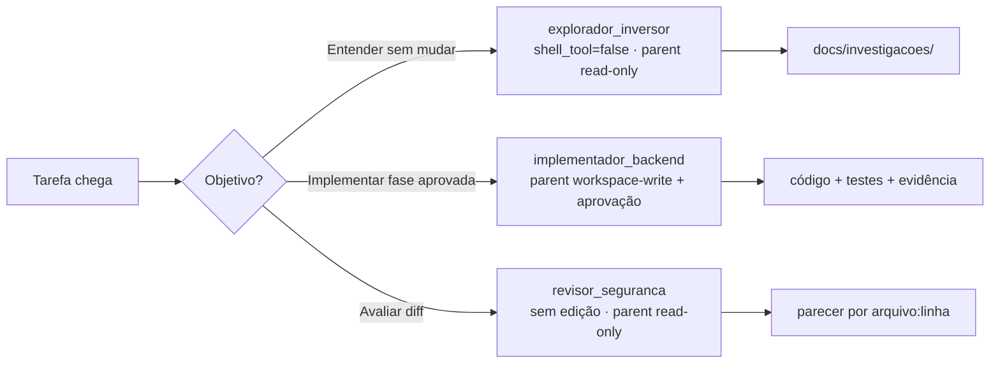

# 🪪 Subagentes e custom agents — quem executa e até onde pode ir

**Pergunta que responde:** _"Quem deve fazer isso, com qual modelo e quais são seus limites?"_

---

## O que o Codex realmente oferece

O Codex tem **subagentes de verdade**. Ele pode disparar agentes especializados em
paralelo e consolidar os resultados em uma única resposta — útil para explorar o
legado, revisar um PR por vários ângulos ou tocar um plano com partes
independentes. Esse recurso vem ligado por padrão e aparece igual na **extensão do
VS Code**, no Codex CLI e no app desktop (a extensão usa o mesmo agente e a mesma
configuração do CLI).

O Codex já traz três agentes **embutidos**:

- `default` — agente de uso geral (fallback).
- `worker` — focado em execução: implementar e corrigir.
- `explorer` — focado em leitura: exploração de código.

E você pode definir **custom agents** — papéis especializados do seu projeto — em
**arquivos TOML**, um arquivo por agente:

- 📂 `~/.codex/agents/*.toml` → agentes pessoais (valem em qualquer repositório).
- 📂 `<repo>/.codex/agents/*.toml` → agentes do projeto, versionados com o time.

> ⚠️ **Correção importante.** Não existe "perfil de agente em Markdown que o Codex
> carrega sozinho". O formato oficial de custom agent é **TOML em `.codex/agents/`**.
> Um `.md` em `docs/` pode servir de documentação para humanos, mas quem o Codex lê
> como agente é o `.toml`.

---

## Anatomia de um custom agent (`.toml`)

Todo arquivo de custom agent define **um** agente e **exige** três campos:

| Campo                                         | Obrigatório | O que faz                                                                  |
| --------------------------------------------- | ----------- | -------------------------------------------------------------------------- |
| `name`                                        | ✅          | Nome usado pelo Codex ao escolher/disparar o agente (é a fonte da verdade) |
| `description`                                 | ✅          | Quando o Codex deve usar este agente                                       |
| `developer_instructions`                      | ✅          | O "system prompt" do papel: objetivo, regras, estilo e limites             |
| `model`                                       | —           | Modelo do agente (ex.: um modelo rápido para varredura)                    |
| `model_reasoning_effort`                      | —           | Esforço de raciocínio: `low`, `medium`, `high`, `xhigh`, `max`, `ultra`    |
| `model_reasoning_summary` / `model_verbosity` | —           | Ajustes finos de saída do modelo                                           |

```toml
# <repo>/.codex/agents/revisor-seguranca.toml
name = "revisor_seguranca"
description = "Revisor de PR focado em isolamento de tenant, autorização e comandos físicos auditáveis."
model = "gpt-6.1-sol"
model_reasoning_effort = "high"
developer_instructions = """
Revise como dono do sistema. Não edite arquivos.
Priorize quebra de tenant, autorização ausente, segredo em log, evento SSE que
vaza dado bruto, falta de timeout/cancelamento em D-Bus e comando físico sem
auditoria/idempotência. Para cada achado, dê severidade, arquivo:linha, cenário
de falha e a correção mínima.
"""
```

> 🧠 O Codex identifica o agente pelo campo `name`, não pelo nome do arquivo. Casar
> os dois (`revisor-seguranca.toml` → `name = "revisor_seguranca"`) é só a convenção
> mais simples. Se um custom agent tiver o mesmo nome de um embutido (`explorer`,
> por exemplo), o seu tem prioridade.

> 📌 Os nomes de modelo (`gpt-6.1-sol` para raciocínio exigente, `gpt-6-luna` para
> varredura rápida) seguem os exemplos da documentação. Use um modelo a que sua conta
> ou workspace tenha acesso; se não existir para você, troque pelo equivalente.

---

## O ponto que mais gera erro: permissões são do **parent**, não do arquivo

Aqui mora a diferença mais importante em relação ao Kiro. **O custom agent não
define sandbox nem política de aprovação.** Ele **herda** do parent (a sessão que o
disparou): mesmas permissões, mesmo provider e mesmos servidores MCP. Um arquivo de
agente **não pode** sobrescrever `sandbox_mode`, `approval_policy`, `model_provider`
nem `mcp_servers`.

O que o arquivo do agente **pode** fazer é **reduzir capacidades**:

```toml
# Deixar um agente puramente de leitura/análise, sem shell:
[features]
shell_tool = false        # sem execução de comandos
request_permissions_tool = false

# Desligar uma skill específica para este agente:
[[skills.config]]
path = "/caminho/para/skill/SKILL.md"
enabled = false
```

Chaves úteis de redução: `features.shell_tool`, `features.apps`,
`features.plugins`, `features.memories`, `features.request_permissions_tool`;
`skills.bundled.enabled = false`; `skills.include_instructions = false`.

> 🔒 **Como fazer um "explorador read-only" de verdade.** Instruir "não edite" no
> `developer_instructions` ajuda, mas **não cria** uma sandbox separada. A fronteira
> real vem da **sessão parent**: rode em modo read-only (ou escolha o modo de
> permissão certo na extensão) e, se quiser garantir, zere `features.shell_tool` no
> agente. Instrução orienta; sandbox e aprovação **impõem**.

---

## Camadas de autonomia com freios

| Camada                          | Pergunta                                        | Onde se configura                               | Exemplo SolarFleet OS                                          |
| ------------------------------- | ----------------------------------------------- | ----------------------------------------------- | -------------------------------------------------------------- |
| **Custom agent**                | Quem está trabalhando?                          | `.codex/agents/*.toml`                          | explorador, implementador backend, revisor de segurança        |
| **Prompt da tarefa**            | O que entregar agora?                           | o que você digita                               | mapa de fluxo, diff pequeno, parecer de risco                  |
| **Modo de permissão / sandbox** | Onde pode ler/escrever e o que exige aprovação? | sessão (`/permissions`) ou `.codex/config.toml` | `read-only` para descobrir; `workspace-write` para implementar |

Na **extensão do VS Code**, o modo de permissão fica no seletor abaixo do campo de
mensagem:

- **Chat** → leitura (equivale a `sandbox_mode = "read-only"`).
- **Agent** → preset "Auto": `workspace-write` + aprovação `on-request`.
- **Agent (Full Access)** → `danger-full-access` (sem sandbox nem aprovação; use com cautela).

> 💡 **Subagentes herdam o modo escolhido no parent.** Selecione o modo de permissão
> **antes** de pedir a delegação. Um subagente "revisor" só fica realmente read-only
> se a sessão parent estiver em Chat/read-only.

A política equivalente em `<repo>/.codex/config.toml`:

```toml
approval_policy = "on-request"      # on-request (interativo) ou never (não interativo)
sandbox_mode    = "workspace-write" # read-only | workspace-write | danger-full-access

# Opcional: liberar rede dentro do workspace-write (desligada por padrão)
# [sandbox_workspace_write]
# network_access = true
```

Isso é um limite da **sessão de desenvolvimento** — não substitui RBAC, revisão, CI
ou proteção de branch. Em `workspace-write`, o Codex ainda trata `.git`, `.codex`,
`.agents` e `.aws` como somente leitura.

---

## Configuração global dos subagentes (`[agents]`)

Os parâmetros de orquestração ficam em `[agents]`, no `.codex/config.toml` do
projeto ou no `~/.codex/config.toml`:

```toml
[agents]
enabled = true                          # recurso ligado por padrão
max_concurrent_threads_per_session = 6  # teto de threads de subagente simultâneas
default_subagent_model = "gpt-6-luna"   # modelo padrão de quem é disparado
default_subagent_reasoning_effort = "medium"
```

> ⚙️ Um pedido explícito de modelo no prompt vence o `default_subagent_model`. Se
> nada for definido, o subagente herda o modelo e o esforço do parent.

---

## Três papéis úteis no produto de inversores



- **explorador_inversor:** traça REST → FastAPI → D-Bus → dispositivo, sem editar.
- **implementador_backend:** executa uma única task aprovada, em diffs pequenos, com checks.
- **revisor_seguranca:** procura quebra de tenant, SSE sem autorização, segredos,
  comando físico sem auditoria e regressões de segurança.

Os arquivos `.toml` completos do explorador e do implementador (este enriquecido com
skills sob demanda e regras de negócio) estão em
[04b · Custom agents do SolarFleet OS](04b-exemplos-papeis.md); o revisor segue a
mesma forma do exemplo de anatomia acima.

---

## Como invocar subagentes

Você pede a delegação **em linguagem natural** — não há um comando especial. O Codex
delega quando você pede diretamente ou quando um `AGENTS.md`/skill aplicável orienta
isso. Um bom prompt diz **como dividir**, **se deve esperar todos** e **qual resumo**
retornar:

> Revise este branch contra `main` com subagentes em paralelo. Use `explorador_inversor`
> para mapear os caminhos afetados e `revisor_seguranca` para achar riscos reais. Espere
> os dois e resuma por categoria, com `arquivo:linha` e severidade.

> ⚠️ Cada subagente faz seu próprio trabalho de modelo e ferramentas, então um fluxo
> com subagentes **consome mais tokens** que uma execução única. Use-os para ganho
> real: tarefas paralelas e de leitura (explorar, revisar, triar). Em escrita
> concorrente, prefira um único implementador para evitar conflitos.

---

## O que colocar no `developer_instructions` de um papel

- 🎭 **Papel e objetivo:** "Você é um engenheiro sênior de integração embarcada...".
- 📏 **Escopo:** diretórios, contrato, task e o que não deve ser alterado.
- 🧾 **Saída:** plano, diagnóstico, checklist, diff ou parecer.
- 🧭 **Ambiguidade:** listar hipóteses e parar antes de assumir comportamento físico.
- ✅ **Evidência:** quais testes e comandos reportar.
- 🔒 **Limites:** sem `git push`, deploy, comando no inversor ou segredo — reforçados
  pela sandbox do parent, não só pelo texto.

> 🧠 **Custom agent vs `AGENTS.md`:** o agente muda conforme a tarefa (quem trabalha);
> o `AGENTS.md` vale para qualquer tarefa naquela parte do projeto (o que é verdade).
> Nunca esconda uma regra crítica de segurança apenas no arquivo de um agente — ela
> precisa valer para todos.

---


---

<p align="center">
  <a href="03-agents-md.md">⬅️ AGENTS.md</a> · <a href="05-skills.md">Skills ➡️</a>
</p>
