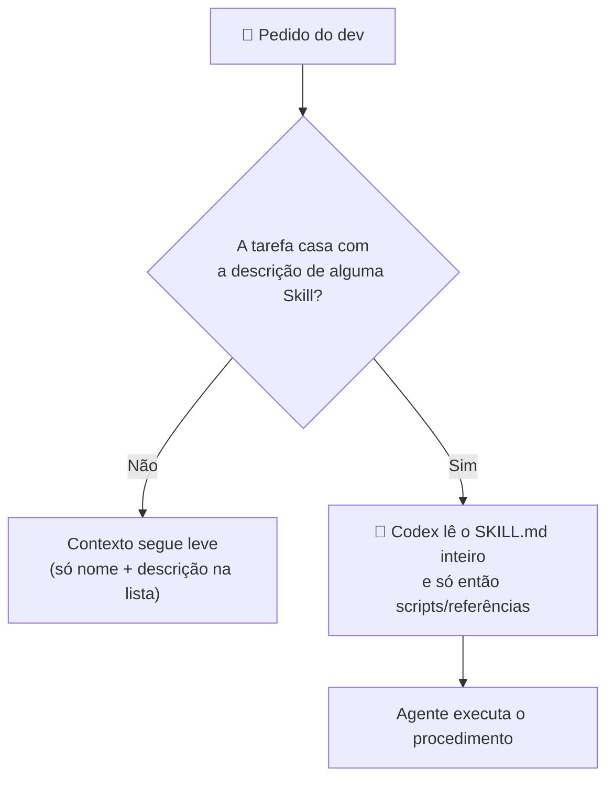

# 📗 Skills — o saber-fazer sob demanda

**Pergunta que responde:** _"Como se faz esse tipo de tarefa aqui?"_

---

## O que é

Uma **Skill** é um diretório com um arquivo **`SKILL.md`** que ensina um fluxo
repetível ao agente. Ela pode conter instruções, referências, scripts e assets.
As Skills seguem o **padrão aberto de agent skills** e funcionam igual na extensão
do VS Code, no Codex CLI e no app desktop.

O Codex começa vendo só o **nome, a descrição e o caminho** de cada Skill
disponível e carrega o `SKILL.md` completo apenas quando decide usá-la — a chamada
**revelação progressiva**. Por isso o nome e a descrição precisam dizer exatamente
_quando_ a Skill é útil.

> 📂 **Onde o Codex procura Skills.** Ele varre `.agents/skills/` em cada diretório,
> do seu diretório atual até a raiz do repositório, e também sua pasta pessoal:

| Escopo            | Local                                       | Para quê                                                    |
| ----------------- | ------------------------------------------- | ----------------------------------------------------------- |
| **Repositório**   | `<repo>/.agents/skills/<nome>/SKILL.md`     | fluxos do projeto, versionados com o time                   |
| **Subárvore**     | `<subpasta>/.agents/skills/`                | fluxos de um módulo/serviço específico                      |
| **Pessoal**       | `~/.agents/skills/`                         | fluxos seus, válidos em qualquer repositório                |
| **Admin/Sistema** | `/etc/codex/skills` e as embutidas do Codex | padrões da máquina e Skills nativas (`skill-creator`, etc.) |

> ⚠️ **Correção importante.** A Skill de projeto mora em **`.agents/skills/`**, não
> dentro de uma pasta `plugins/`. Plugin é a unidade de **distribuição** (ver o fim
> do capítulo); o formato de autoria de uma Skill é sempre o diretório com `SKILL.md`.

---

## O conceito-chave: revelação progressiva



A lista inicial de Skills ocupa, por padrão, no máximo **2% da janela de contexto**
do modelo (ajustável com `skills.max_context_tokens`, teto de 10.000 tokens). Se
houver muitas Skills, o Codex encurta as descrições primeiro — então **front-load**:
coloque o caso de uso e as palavras-gatilho no começo da descrição.

---

## Anatomia de uma Skill

```text
.agents/skills/adicionar-telemetria-sse/
├── SKILL.md            # obrigatório: instruções + metadados (name, description)
├── scripts/            # opcional: scripts chamados pelo fluxo
├── references/         # opcional: documentação de apoio
├── assets/             # opcional: templates e recursos
└── agents/
    └── openai.yaml     # opcional: metadados de UI, política e dependências (MCP)
```

O `SKILL.md` começa com um front matter mínimo de **`name` + `description`**:

```markdown
---
name: adicionar-telemetria-sse
description:
  Adiciona uma nova métrica de telemetria do inversor até a IHM Angular,
  passando por contrato, D-Bus, FastAPI e SSE. Use para "nova métrica", "telemetria",
  "evento SSE", "campo do inversor" ou "card de monitoramento".
---

# Adicionar telemetria ponta a ponta

## Quando usar

Quando um valor publicado pelo serviço embarcado precisa aparecer, tipado e testado,
na IHM white-label.

## Passo a passo

1. Atualize o contrato em `contracts/` com nome, unidade, precisão e semântica.
2. Adapte a leitura D-Bus no backend; normalize e valide o valor.
3. Publique SSE versionado com `tenant_id`, `device_id`, `sequence` e timestamp.
4. Atualize o service Angular e o componente, preservando tema e acessibilidade.
5. Escreva testes de contrato, backend e Jest para valor, ausência e reconexão.

## Checklist de pronto

- [ ] Unidade e nome do campo não são ambíguos
- [ ] Tenant e dispositivo são preservados em toda a cadeia
- [ ] Não há acesso D-Bus no frontend
- [ ] Eventos fora de ordem/reconexão não exibem valor inventado
- [ ] Checks afetados passaram
```

> 💡 **Prefira instruções a scripts**, a menos que você precise de comportamento
> determinístico ou de uma ferramenta externa. Um script em `scripts/` deve ser
> pequeno, revisável e chamado só quando necessário.

---

## Como invocar uma Skill

- 🅰️ **Explícita:** digite `$nome-da-skill` no campo de mensagem, ou rode `/skills`
  para ver e escolher. (Na extensão do VS Code e no CLI é o mesmo.)
- 🅱️ **Implícita:** o Codex escolhe a Skill quando a tarefa casa com a `description`.
  Descrição clara = ativação confiável.

Para **criar** uma Skill guiado, invoque a Skill nativa `$skill-creator`. Para
instalar Skills prontas, use `$skill-installer`. O Codex detecta Skills novas ou
alteradas automaticamente; se algo não aparecer, reinicie o Codex.

---

## Configuração: ligar, desligar e orçar contexto

Você não precisa de nada para uma Skill de repositório ser descoberta — basta ela
estar em `.agents/skills/`. Para **desligar** uma Skill específica sem apagá-la, use
`[[skills.config]]` no `~/.codex/config.toml`:

```toml
[[skills.config]]
path = "/caminho/para/.agents/skills/adicionar-telemetria-sse/SKILL.md"
enabled = false

# Opcional: aumentar o orçamento da lista inicial de Skills (teto 10000)
# [skills]
# max_context_tokens = 8000
```

O arquivo opcional `agents/openai.yaml` controla aparência, política de invocação e
dependências de ferramentas (por exemplo, exigir um servidor MCP):

```yaml
interface:
  display_name: "Adicionar telemetria SSE"
  short_description: "Fluxo contrato → D-Bus → FastAPI → SSE → Angular"
policy:
  allow_implicit_invocation: true # false = só via $skill explícito
dependencies:
  tools:
    - type: "mcp"
      value: "docs_inversor"
      description: "Servidor MCP de documentação do SolarFleet OS"
      transport: "streamable_http"
      url: "https://developers.openai.com/mcp"
```

O exemplo extenso de Skill, de um segundo procedimento e da distribuição por plugin
está em [05b · Exemplos completos de Skills](05b-exemplos-skills.md).

---

## O que colocar DENTRO de uma Skill

✅ **Coloque:**

- Procedimentos passo a passo que se repetem.
- Checklist de pronto e evidências de verificação.
- Exemplos canônicos, templates e referências locais.
- Limites de segurança e compatibilidade específicos daquele procedimento.

❌ **Não coloque:**

- Regras universais do projeto (isso é `AGENTS.md`).
- Política geral de sandbox/aprovação (isso é configuração da sessão/organização).
- Segredos, certificados, endpoints privados ou dados de clientes.

---

## Distribuição: de `.agents/skills/` para plugin

Para usar e iterar localmente, `.agents/skills/` basta. Quando você quiser
**distribuir** uma Skill para outros times, agrupar várias Skills ou enviá-la junto
com um conector MCP, empacote-a como **plugin** — a unidade instalável compartilhada
por ChatGPT e Codex.

Em alto nível, um plugin traz um manifesto (`.codex-plugin/plugin.json`) e as Skills;
um marketplace local (`.agents/plugins/marketplace.json`) é referenciado em
`[marketplaces.<nome>]` no `config.toml` e habilitado com `plugins.<plugin@marketplace>.enabled`.
Consulte a página oficial _Build plugins_ para o manifesto completo e a política de
instalação adequada ao seu ambiente — a Skill em si continua sendo o `SKILL.md`.

---

## `AGENTS.md` × Skill × custom agent

|              | `AGENTS.md`              | Skill                             | Custom agent                 |
| ------------ | ------------------------ | --------------------------------- | ---------------------------- |
| Responde     | _O que é verdade_        | _Como fazer_                      | _Quem está trabalhando_      |
| Quando entra | Pelo diretório aplicável | Quando a tarefa casa (ou via `$`) | Quando você delega a ele     |
| Natureza     | Fatos e limites          | Procedimento                      | Papel + modelo + capacidades |
| Mora em      | `AGENTS.md`              | `.agents/skills/<nome>/SKILL.md`  | `.codex/agents/<nome>.toml`  |
| Exemplo      | "SSE é versionado"       | "adicionar métrica SSE"           | "revisor de segurança"       |

> 🧠 Se você escreveu "passo 1, passo 2, passo 3" em `AGENTS.md`, provavelmente
> aquilo deve virar uma Skill.

---


---

<p align="center">
  <a href="04-papeis-e-politicas.md">⬅️ Subagentes e custom agents</a> · <a href="06-prompt-engineering.md">Prompt Engineering ➡️</a>
</p>
