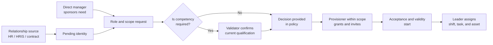

# Employee lifecycle governance

## Recommended decision: federated model with separate controls

The Owner does not register every hire, and the management hierarchy does not automatically grant
power. By default, the tenant must use a federated model: the relationship source attests who
belongs to the organization; leadership sponsors the need; competency is verified when required;
and a policy-limited provisioner makes access effective. These responsibilities refine the personas
in [01](01-personas-roles-and-responsibilities.md), without replacing their limits of action.

The tenant may centralize these activities in an HR Operations team or distribute them among
site/area access administrators. The separation of responsibilities below remains mandatory, even
when one person accumulates functions permitted by policy.

The invitation may be sent before the first day to prepare the identity, but it does not activate
any assignment before the start date and other conditions. This flow specializes the assignments
in [05](05-assignments-scopes-and-assets.md), segregation in [06](06-state-rules-and-segregation.md),
and review in [07](07-identities-delegation-exceptions-and-auditing.md).

## Different verbs, different responsible parties

| Act | Who normally performs it | What they do — and do not do |
|---|---|---|
| Register identity | HR/HRIS or contract manager; exceptionally provisioner | Creates a pending relationship with person, company, start/end, and manager. Does not create role or access. |
| Invite | Authorized access provisioner | Delivers a means to activate identity. Invitation is not a privilege grant. |
| Propose/sponsor | Direct manager, area/site manager, or contract owner | Declares required role, justification, site/line, asset, shift, and validity. Does not grant. |
| Validate competency | Defined training, quality, EHS, or technical owner | Confirms the requirement applicable to the work. Does not assign role or asset. |
| Approve need | Authority defined by policy for risk and scope | Accepts or refuses the request; must not approve their own conflicted privilege. |
| Grant role and scope | Authorized access provisioner | Materializes only the approved request and within their delegation. |
| Assign work | Line/shift leader within their scope | Chooses task, asset, and shift among already granted access; does not create role. |
| Activate, review, or revoke | Provisioner, triggered by relationship source and manager review | Activates satisfied conditions, confirms periodic relevance, or ends access. |

## Authority by organizational function

| Function | Daily responsibility | Explicit limit |
|---|---|---|
| Owner | Defines policy, appoints access authorities, follows reviews, and decides governance/continuity exceptions | Is not a hiring center and does not gain production, quality, or asset access. |
| HR / HRIS | Trusted source for hiring, change, leave, and termination; may sponsor or operate access only if also given their own assignment | Employment relationship is not equivalent to an Andromeda role; HR receives no grant authority merely by existing. |
| Direct manager | Sponsors their team's access, reports job changes, and confirms review | Hierarchy/job does not allow inviting, granting, or viewing the whole plant without assignment. |
| Area or site manager | Sponsors/authorizes needs in their domain according to policy and is responsible for local reviews | Receives no global administration or operational access for being a manager. |
| Local access administrator | Checks evidence and makes invitation, role, scope, validity, suspension, and revocation effective in the assigned site/area | Does not invent privilege, exceed scope, or approve own elevation. |
| Line/shift leader | After valid access, distributes people by asset, task, and shift on their line and signals a need for change | Does not freely register, grant role, or assign access to another line. |
| Contract owner | For a contractor, attests supplier company, contract, term, sponsoring manager, and permitted location | Does not replace competency validation or the provisioner. |

The hiring party need not be the granting party. For example, site management may sponsor a new
area manager's entry; the site access administrator grants the approved role; and the Owner
intervenes only if policy requires an exception or the appointment of an authority.

## Decision and activation rule

1. The relationship source registers or updates employee/contractor status and their manager.
2. The sponsoring manager proposes the existing role package, minimum scope, and duration; a new
   job never expands access without an explicit request.
3. When work requires qualification, the validator confirms the condition before activation.
4. The designated authority approves need according to risk; the provisioner checks scope,
   conflict, and evidence, grants, and sends/renews the invitation.
5. The assignment becomes active only after acceptance, start date, valid relationship, and other prerequisites.
6. The leader then assigns schedule and asset within the assignment's existing reach. Designation
   does not overcome a competency, quality, EHS, or state block, as defined in [05](05-assignments-scopes-and-assets.md).

For contractors, the contract owner performs the relationship-source function; the record includes
company, contract, internal sponsor, locations, and end date. All access ends at contract end
unless newly validated—it does not become employee access.

## Exceptional delegation to the line leader

A leader may also be a **delegated local provisioner**, but receives a separate, named, temporary,
and auditable assignment; the title “leader” never presumes it. Policy must limit delegation to
their line, pre-approved lower-risk packages (for example, Operator or Setup Technician), people
with a valid relationship, and defined term/review.

Even when delegated, the leader does not grant to themselves, their own manager, outside the line,
or Owner roles, access administration, engineering/publication, quality approval, critical
maintenance return, critical EHS, integration, or auditing. They need sponsorship and competency
evidence; another provisioner/authority handles their own request and any exception.

Mandatory controls prevent casual elevation: closed role catalog; comparison of requested and
delegated scope; standard validity/review; required reason; dual decision for cases defined in
[06](06-state-rules-and-segregation.md); and a complete trail of proposal, grant, designation, use,
and revocation. Broad or privileged access expires or enters defined review—it never becomes
permanent merely because it was used repeatedly.
