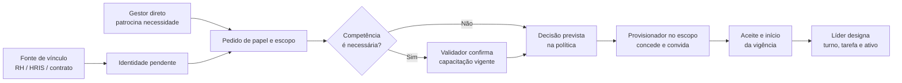

# Governança do ciclo de vida de colaboradores

## Decisão recomendada: modelo federado com controles separados

O Owner não cadastra cada admissão, e a hierarquia de gestão não concede poderes
automaticamente. O tenant deve usar, por padrão, um modelo federado: a fonte de vínculo
atesta quem pertence à organização; a liderança patrocina a necessidade; a competência é
verificada quando exigida; e um provisionador limitado pela política efetiva o acesso.
Essas responsabilidades refinam as personas de [01](01-personas-papeis-e-responsabilidades.md),
sem substituir seus limites de atuação.

O tenant pode centralizar estas atividades numa equipe de RH Operações ou distribuí-las entre
administradores de acesso de site/área. A separação de responsabilidades abaixo permanece
obrigatória, mesmo quando uma pessoa acumula funções permitidas pela política.

O convite pode ser enviado antes do primeiro dia para preparar a identidade, mas não ativa
nenhuma atribuição antes da data de início e das demais condições. Este fluxo especializa as
atribuições de [05](05-atribuicoes-escopos-e-ativos.md), a segregação de
[06](06-regras-de-estado-e-segregacao.md) e a revisão de [07](07-identidades-delegacao-excecao-e-auditoria.md).

## Verbos diferentes, responsáveis diferentes

| Ato | Quem normalmente executa | O que faz — e o que não faz |
|---|---|---|
| Registrar identidade | RH/HRIS ou gestor de contrato; excepcionalmente provisionador | Cria vínculo pendente com pessoa, empresa, início/fim e gestor. Não cria papel nem acesso. |
| Convidar | Provisionador de acesso autorizado | Entrega meio de ativar a identidade. Convite não é concessão de privilégio. |
| Propor/patrocinar | Gestor direto, gestor de área/site ou responsável do contrato | Declara função, justificativa, site/linha, ativo, turno e vigência necessários. Não concede. |
| Validar competência | Responsável de treinamento, qualidade, EHS ou dono técnico definido | Confirma requisito aplicável ao trabalho. Não atribui papel ou ativo. |
| Aprovar a necessidade | Autoridade definida na política para risco e escopo | Aceita ou recusa o pedido; não deve aprovar privilégio próprio conflitado. |
| Conceder papel e escopo | Provisionador de acesso autorizado | Materializa somente o pedido aprovado e dentro de sua delegação. |
| Designar trabalho | Líder de linha/turno no seu recorte | Escolhe tarefa, ativo e turno dentre acessos já concedidos; não cria papel. |
| Ativar, revisar ou revogar | Provisionador, com gatilho da fonte de vínculo e revisão do gestor | Ativa condições satisfeitas, confirma pertinência periódica ou encerra acesso. |

## Autoridade por função organizacional

| Função | Responsabilidade diária | Limite explícito |
|---|---|---|
| Owner | Define política, nomeia autoridades de acesso, acompanha revisões e decide exceção de governança/continuidade | Não é central de admissões nem ganha produção, qualidade ou ativos. |
| RH / HRIS | É fonte confiável de admissão, mudança, afastamento e desligamento; pode patrocinar ou operar acesso se também receber atribuição própria | Vínculo de emprego não equivale a papel Andromeda; RH não recebe autoridade de concessão só por existir. |
| Gestor direto | Patrocina acesso de sua equipe, informa mudança de cargo e confirma revisão | Hierarquia/cargo não permite convidar, conceder ou ver toda a planta sem atribuição. |
| Gestor de área ou site | Patrocina/autoriza necessidades de seu domínio conforme política e responde por revisões locais | Não recebe administração global nem acessos operacionais por ser gestor. |
| Administrador de acesso local | Confere evidências e efetiva convite, papel, escopo, vigência, suspensão e revogação no site/área designados | Não inventa privilégio, não extrapola escopo e não aprova elevação própria. |
| Líder de linha/turno | Após acesso válido, distribui pessoas por ativo, tarefa e turno em sua linha e sinaliza necessidade de mudança | Não cadastra livremente, não concede papel e não atribui acesso a outra linha. |
| Responsável de contrato | Para terceirizado, atesta empresa fornecedora, contrato, período, gestor patrocinador e local permitido | Não substitui a validação de competência ou o provisionador. |

Quem contrata não precisa ser quem concede. Por exemplo, a gerência de site pode patrocinar a
entrada da nova gerente de área; o administrador de acesso do site concede o papel aprovado; e
o Owner somente intervém se a política exigir exceção ou a nomeação de uma autoridade.

## Regra de decisão e ativação

1. A fonte de vínculo registra ou atualiza o status de colaborador/terceirizado e seu gestor.
2. O gestor patrocinador propõe o pacote de papel existente, o escopo mínimo e a duração; novo
   cargo nunca amplia acessos sem pedido explícito.
3. Quando o trabalho exigir capacitação, o validador confirma a condição antes da ativação.
4. A autoridade prevista aprova a necessidade conforme risco; o provisionador confere escopo,
   conflito e evidência, concede e envia/renova o convite.
5. A atribuição só fica ativa após aceite, data de início, vínculo válido e demais pré-condições.
6. O líder então designa escala e ativo dentro do que a atribuição já alcança. A designação não
   vence bloqueio de competência, qualidade, EHS ou estado, como definido em [05](05-atribuicoes-escopos-e-ativos.md).

Para terceirizados, o responsável de contrato ocupa a função de fonte de vínculo; o registro
inclui empresa, contrato, patrocinador interno, locais e data final. Todo acesso termina no
fim do contrato salvo nova validação — não se converte em acesso de empregado.

## Delegação excepcional ao líder de linha

Um líder pode ser também **provisionador local delegado**, mas recebe uma atribuição separada,
nominal, temporária e auditável; o título “líder” nunca a presume. A política deve limitar a
delegação à sua linha, a pacotes pré-aprovados de menor risco (por exemplo, Operador ou Técnico
de setup), a pessoas com vínculo válido e a prazo/revisão definidos.

Mesmo delegado, o líder não concede a si, ao próprio gestor, fora da linha, nem papéis de Owner,
administração de acesso, engenharia/publicação, aprovação de qualidade, retorno crítico de
manutenção, EHS crítico, integração ou auditoria. Ele precisa de patrocínio e evidência de
competência; outro provisionador/autoridade trata seu próprio pedido e qualquer exceção.

Controles obrigatórios impedem elevação casual: catálogo fechado de papéis; comparação entre
escopo solicitado e escopo delegado; vigência padrão/revisão; motivo obrigatório; dupla decisão
para casos definidos em [06](06-regras-de-estado-e-segregacao.md); e trilha completa de
proposta, concessão, designação, uso e revogação. Acesso amplo ou privilegiado expira ou entra
em revisão definida — nunca se torna permanente apenas porque foi usado repetidamente.

